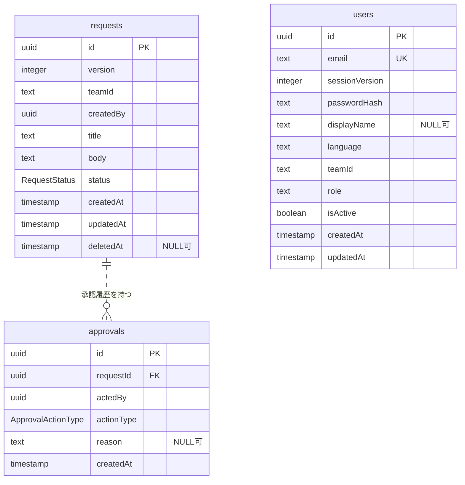

# MiniFlowのER図

現行のPostgreSQLには `users`、`requests`、`approvals` の3テーブルがあります。
テーブルと列は [Prismaスキーマ](../apps/api/prisma/schema.prisma)、DBに適用される制約と索引は
[マイグレーション](../apps/api/prisma/migrations) を参照してください。

## 関連と制約

- `approvals.requestId` は `requests.id` を参照する必須の外部キーです。申請をDBから物理削除すると、対応する承認履歴も連鎖削除されます。
- `requests.createdBy` と `approvals.actedBy` は利用者IDを保持します。どちらにも `users` への外部キー制約はありません。
- `users.teamId` と `requests.teamId` はチームの識別子を文字列で保持します。チーム用のテーブルはなく、チーム単位のアクセス制御はアプリケーションが担当します。
- `requests.status` の値は `Draft`、`Pending`、`Approved`、`Rejected`、`Deleted` です。通常の申請削除は `Deleted` と `deletedAt` による論理削除で、両列の整合性はアプリケーションが管理します。
- `approvals.actionType` の値は `Approved` と `Rejected` です。差し戻し後に再提出された申請を同じ利用者が再度決裁できるよう、`requestId` と `actedBy` の組に一意制約はありません。

## 索引

| テーブル | 列（索引順） | 種類 |
| --- | --- | --- |
| `users` | `email` | 一意 |
| `users` | `teamId`, `role`, `isActive` | 複合 |
| `requests` | `teamId`, `status`, `createdAt` | 複合 |
| `approvals` | `requestId`, `createdAt` | 複合 |

各テーブルの主キー `id` にも一意索引があります。

## 更新とセッションの世代

`requests.version` は申請の競合検出に使う番号です。保存時に読み出し時点の番号と照合します。
`users.sessionVersion` はログインセッションの失効判定に使う番号です。パスワード変更時に更新されます。
どちらも初期値は `0` です。APIの振る舞いは [API仕様](API.md) を参照してください。
