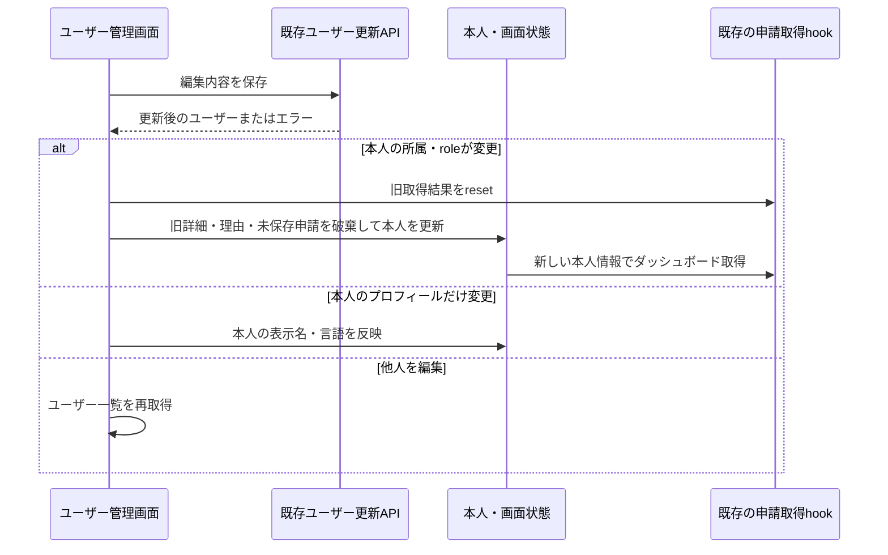

# Plan: 管理者本人の所属・権限変更後の画面同期

- 計画version: 1、2026-10-27承認。
- 要求: PR #8マージ後の「引き続き開発お願いします」（2026-10-27）。既存レビューR15の本人情報同期を優先する提案。
- Git: `main`をfetchし、`157e37d`へfast-forwardで同期。未コミット変更はなかった。
- 調査: `MiniFlowApp.handleUserUpdate`はPATCH応答を破棄し、ユーザー一覧だけを再取得する。`currentUser`・フォームのteam・選択中の申請は更新されず、既存の`useRequestCollection`も旧identityのままになる。

## 範囲と判断

管理者がユーザー管理で自分を編集した際、保存成功後の本人情報を画面へ同期する。APIの管理者権限、チーム割当、既存のプロフィール更新契約は変更しない。本人の表示名・言語だけの更新と、所属・roleが変わる更新を区別する。

所属やroleが変わった場合は、旧申請の詳細・承認理由・一覧・集計を破棄してダッシュボードへ移る。未保存の申請作成フォームの件名・本文は消し、新しいチームへ持ち越さない。これは今回承認を求める挙動。代替は文面を保持する案だが、意図せず別チームへ提出するリスクがあるため、破棄して変更通知を示す案を推奨する。DBに保存済みの申請は変更・削除しない。

表示名・言語だけなら所属の境界を変えないので申請作成の入力は維持する。他人を編集した場合は現在の本人情報を変更しない。自分のroleが管理者以外へ変わった場合、管理者専用一覧の再取得を行わず、管理画面を表示しない。

言語辞書の共有可変状態と全画面の分割は別の課題で、今回は同時に変更しない。新規依存・API・DB構造・migration・外部サービス追加はない。

## 実装と責務

- `MiniFlowApp.tsx`: 更新応答から本人情報を反映し、所属・roleの変更時に画面状態を破棄する。HTTPは既存`authApi.updateUser`を使う。本人以外の更新は現在の挙動を保つ。
- 表示状態の切替条件に重要な分岐があるため、小さい純粋な判定関数へ切り出して単体試験する。APIや画面の状態そのものはコンポーネントが所有する。
- `useRequestCollection`の既存のreset・identity無効化を再利用する。古い所属の件数や一覧を新しい所属へ適用しない。
- 新規ファイルの冒頭・公開関数に、本人/他人と所属変更の契約を記載する。ステアリングの地図も更新する。

保存失敗は本人情報・入力を維持し既存のエラーを表示する。401は既存のセッション破棄を再利用する。入力の許容値やサーバーの認可をクライアントで上書きしない。

## 受け入れ条件と試験

| ID | 受け入れ条件 | 確認方法 |
| --- | --- | --- |
| AC1 | 自分の所属変更後、表示と作成フォームのteamが一致し、旧詳細・一覧・集計・未保存文面が残らない | 純粋判定の単体試験、実ブラウザで2チームの架空データを切替 |
| AC2 | 自分のrole変更で管理者用画面・再取得が残らない | 単体試験、既存HTTP契約を使うブラウザ確認 |
| AC3 | 自分の表示名・言語だけの変更で入力文面を維持する。他人編集で現在の本人情報を変えない | 単体試験、ブラウザの正常系 |
| AC4 | 更新失敗・認証失効を成功扱いせず、旧所属から遅れて届く一覧を適用しない | 既存の認証試験、遅延応答と失敗のブラウザ確認 |

既存のチーム境界に沿う修正だが、未保存文面の破棄と画面遷移を明示するため仕様書を作る。上の表を仕様・機能/単体試験草案として提示し、実装時に`docs/tests/`と画面仕様へ反映する。

検証はformat・型検査・既存と追加テスト・build・secrets、実ブラウザ、自己レビューと独立レビュー。既存のUI値を使い水準Bを維持する。200%拡大の未確認は引き継ぐ。

ブラウザ試験は、既存のメモリ保存先fixtureと本番HTTPを組み立てたloopbackの試験専用環境を使う。2チーム・架空Admin/Applicant/Approverをメモリに用意し、自己編集・他人編集・エラー・遅延を確認する。既存の手動確認DBへ接続せず、新規DB初期化も行わない。秘密鍵は試験プロセス内だけのダミー値。外部送信はしない。

リスクは未保存文面の意図的な破棄と、表示同期中の古い応答。前者は変更通知、後者は既存のidentity/resetと遅延試験で確認する。rollbackは画面差分を戻すことで行え、保存済みDBの移行は不要。

人間の計画承認: 提示後の会話「ok、通常PRまでお願いします」。実装・検証・通常PRまでを承認。計画と上の破棄方針を提示し、承認後に実装する。通常PRで進める運用はこれまでの指示を引き継ぎ、検証・レビュー後にまとめる。
