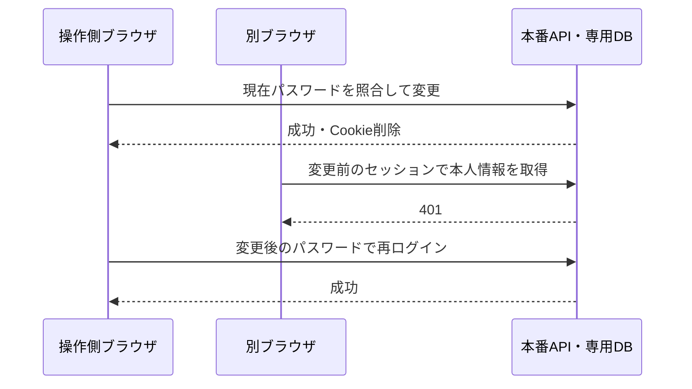

# アカウント設定とパスワード変更のE2E

2026-11-24の会話「引き続きお願いしますe2eもお願いします」を、既存の公開準備・ローカルE2E継続として実施する。基点はfetch済みmain `867cba8`。未マージPRなし。別worktreeでホームページの既存変更を保護する。

今回は既存APIのAC4（パスワード変更で全セッション失効）を実ブラウザから確認する。アプリ仕様・依存・CI・migrationファイルは変更しない。API仕様は`docs/API.md`を参照し、新機能仕様は作らない。

1. 前回と同じ固定localhost HTTPS・本番API/Web・専用PostgreSQLを再利用する。空の使い捨てDBへ既存9件のmigrationと架空4ユーザーを投入する。新しい実ユーザーや外部配信先は使わない。
2. 同じ架空ユーザーで隔離した2つのブラウザcontextにログインする。表示名・言語の変更と再読込後の保存を確認する。
3. 現在のパスワードが違う変更は拒否され、他方のセッションも引き続き使えることを確認する。
4. 正しい現在パスワードで変更し、操作側のCookie削除・再ログイン表示、他方のセッションの401を確認する。古いパスワードは拒否、新しいパスワードではログインでき、日英の切替を戻せることを確認する。
5. 前回14項目も再実行し、SQLで認証世代とprofileを照合する。全体Profile・独立レビュー後に通常PRへまとめる。今回の新規PRはマージせずレビュー可能な状態に残す。

`accountSecurity.mjs`は本人設定の画面シナリオを担当する。入口のlogin・ブラウザ寿命・結果記録を再利用し、シナリオ固有の意図した拒否だけをcallbackで許容する。認可・hash・認証世代の実装は複製しない。既存シナリオを置き換えず、新規moduleへ委ねる。

Security→2つのセッションと旧パスワードの拒否を実ブラウザで検証。Database→専用DBの固定queryで認証世代だけ照合しhashを出力しない。Sensitive data→架空資格情報のみ、Cookieやtokenを証拠に保存しない。終了時にWeb/proxy/専用Composeを停止しDBを破棄する。

検証の穴は前回と同じで、lint・依存脆弱性監査・CIの自動E2Eは未整備。品質基準の変更は今回行わない。実公開TLS/DNS・共有デモ管理・複数ブラウザ・全画面の英語検証は対象外として残す。

環境調整: 元のDB公開port 55449は別projectの`comutto-membership-e2e`が使用していた。既存環境には触れず、一時Compose copyで専用DBを55450へbindする。Compose v2.15.1では`!override`が適用されず最初の起動はport競合で停止したため、固定portだけを変更したcopyを使う。seedは固定URLのportだけを55450に置き換えた一時copyを同じsupport directoryで実行後に削除する。製品・commitするfixtureの接続先は変更しない。

試験の描画待ちはローカル並行buildの負荷を考慮し、5秒から15秒へ変更する。仮の試験待ち上限であり、製品の応答時間目標ではない。API成功と未知エラーの検査は維持し、自動retryは追加しない。
