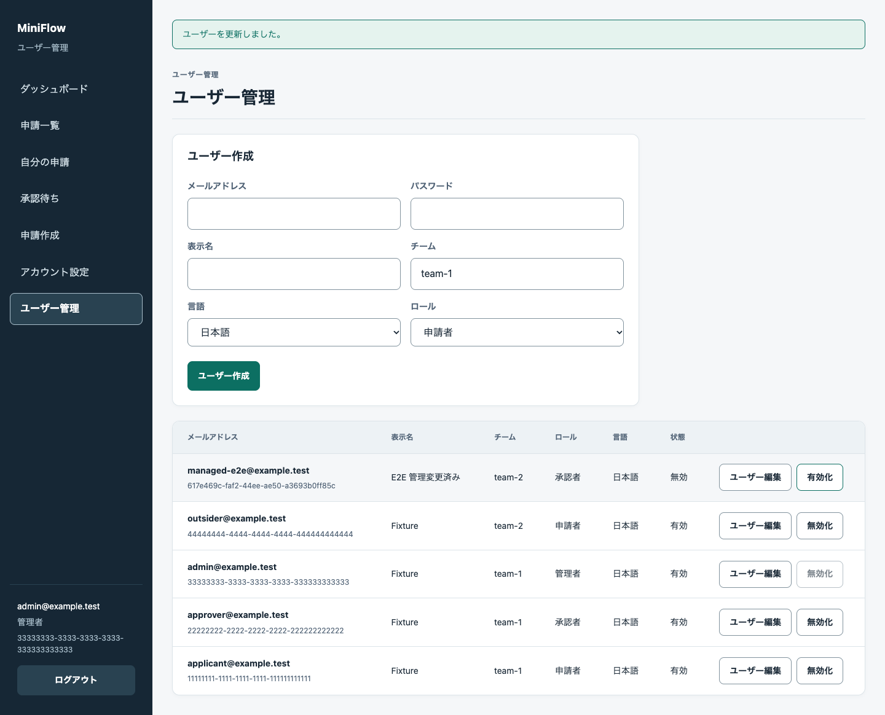

# 管理者操作を含む本番相当E2Eの結果

管理者によるユーザー作成・属性変更・無効化を実ブラウザから確認した。既存の承認フロー9項目と追加5項目、合計14項目が成功した。アプリ・依存・migrationファイル・CIの変更はない。

2026-11-23、main `7cf43f7`を基点に実施。PR #27はCI成功、レビュー指摘と未解決threadなしを確認してマージした。既存ホームページの作業は別worktreeで保護した。

## 実施内容

前回の[起動・migration・seed・停止手順](../container-workflow-e2e/result.md)と同じ専用Compose、本番API image、本番build Web、PostgreSQL16、固定localhost HTTPSを使用した。空の専用DBに既存9件のmigrationと架空4ユーザーを投入した。Playwright 1.65.1、Chrome 157.0.8103.80。自己署名証明書の例外は隔離したブラウザcontextだけで、外部Originへの通信は拒否する。

```sh
node tests/e2e/containerWorkflow.mjs /private/tmp/miniflow-e2e-tools /private/tmp/miniflow-admin-e2e-results
```

| 確認 | 結果 |
| --- | --- |
| 既存の申請作成・提出・差し戻し・修正・再提出・承認、チーム境界、Cookie、再起動、logout | 9項目成功 |
| 管理者が画面から一般ユーザーを作成 | POST 201と一覧表示 |
| 一般ユーザーによる管理操作 | ナビ非表示、一覧GETと有効CSRF付き作成POSTが403 |
| 表示名・所属・ロールの編集 | PATCH 200、一覧へ反映 |
| 既存セッションへの変更反映 | auth/meがApprover/team-2、申請作成の所属は読み取り専用 |
| 無効化 | PATCH 200、既存セッション401、同じ資格情報で再login 400 |

[実行JSON](evidence.json)には14項目と意図したHTTP拒否だけを記録した。HTTPエラーは401が6件、403が4件、400が1件。対応するconsole errorは11件、page errorは0件、未知のHTTP/console errorは0件。APIログのlevel 50/60は0件。今回の実行で失敗ケースはなかった。

SQLでもusers合計5件、追加ユーザーはApprover・team-2・isActive=false、拒否した作成メールの行は0件と確認した。申請はApproved・version 7、判断履歴2件、承認者は同じ1人。request IDは`1caf97a9-fd20-43a2-9b8f-97003c9067a5`。

試験後はブラウザ・Web・proxyを停止し、専用ComposeのAPI/DB/networkを削除した。実ユーザーや既存DB、OSの証明書設定は変更していない。

## 証拠画像



出典: MiniFlow自身のローカル試験画面。2026-11-23、PlaywrightのfullPage screenshotで取得。PNG、1440×1164、127,778 bytes、加工なし。写っているユーザーとデータはすべて専用試験の架空データ。第三者素材の追加なし。画面の権利・再配布条件は既存MiniFlowと同じで、プロジェクト全体のライセンス選定は未確認。

## 全体検証とレビュー

Harnessの設定検証と実行計画を確認後、`NEXT_TELEMETRY_DISABLED=1 node .harness/upstream/scripts/validate.mjs --execute`が成功した。format・型検査・31ファイル392テスト・本番build・秘密情報チェックが成功。lintは既存Profileで未整備のためskip。両E2E moduleの`node --check`と`git diff --check`も成功。標準CIと今回のローカルE2Eは別の検証であり、E2EをCIへ組み込む変更はない。

## 残課題と次の優先項目

実公開先のDNS・信頼されたTLS・配信先は未確認。次は公開先の構成とデモデータの管理を決め、本番URLで同じ認証・認可を再確認する。共有デモの書き込み制限・データ初期化も公開前に整える。

今回の対象外は管理者の自己更新、再有効化後のtoken寿命、英語全画面、複数ブラウザ、CIの自動E2E。標準テスト数とブラウザの14項目を合算しない。

自己レビューはsecurity/data/tests/docs-commentsの観点で差分を照合した。既存9項目と未知エラー拒否を維持し、追加の意図した拒否は対象session・path・method・statusに限定した。シナリオは別module、ブラウザ寿命・認証helper・出力は入口に置き、製品の認可ロジックを複製していない。既存ユーザー変更・品質基準の弱体化なし。業務仕様の変更がなく、新たな仕様書や画面設計図は対象外。人間による画面受け入れは未確認。独立レビューとPRでの確認を残す。
