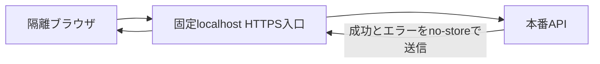

# 個人向けAPI応答を保存させない

2026-11-25のユーザー依頼「PR に問題なければマージしてください。引き続き、公開プレビューに向けた開発とE2Eもお願いします」に基づく公開準備。PR31は最新CI成功・レビュー/未解決threadなしを確認しマージ済み。fetchしたmain f97044aから別worktree/branch codex/api-cache-safetyで作業し、元のホームページ変更は保護する。

既存runbookの「認証付き応答を共有cacheへ保存しない」を具体化する。[仕様](../../specs/api-cache-safety.md)と[試験](../../tests/functional/api-cache-safety.md)の範囲で、APIの送信直前にCache-Control: no-storeを一律設定する。GETだけでなくログイン・更新・拒否・内部エラー・空応答も対象。既存CSRFだけの指定を削除し、正本を組立のhookへまとめる。静的Webのcacheは変更しない。

1. 本番HTTPを注入実行する回帰試験で成功/拒否/内部エラー/HEAD/OPTIONSを確認する。
2. createHttpServerのonSendでAPIのHTTP出力方針を適用する。domain/DB/認可・Cookie契約には触れない。新しい汎用pluginや層を増やさない。
3. 既存E2Eの全API応答のheaderを集計し、従来22項目と新しい保存禁止の確認を実Web/API/DBで実施する。Cookie/body/headerの生値は記録しない。
4. Profile・独立レビュー・通常PRまで。新PRは未マージ。公開先作成やデータ復元は対象外。

Security/Sensitive data → 個人情報と認証応答の保存抑止 → 本番HTTP/ブラウザの応答headerを照合。Web delivery → 設定ファイルだけでなく実応答で確認。Quality → 標準試験とE2Eを区別し、失敗を保存して修正後再実行する。

同じ知識はCSRF routeの1箇所だけに見つかったため置換する。HTTP組立は既存のtransport境界の責務、E2E入口は応答観測、試験は実HTTPの契約を担当する。状態は試験のプロセスだけで保持し終了時に消える。

DBは個別承認済みの固定localhost:55449/miniflow_container_test、Compose miniflow-container-e2eの使い捨てtmpfsだけ。既存9migrationと架空4人を投入しE2E後削除する。共有DBは操作しない。依存/CI/schema/API body変更なし。lint・依存監査・CI自動E2Eは既存の検証の穴で今回変更しない。公開先でのcache設定、過去cacheの消去、ブラウザ履歴やメモリの消去は保証外。
