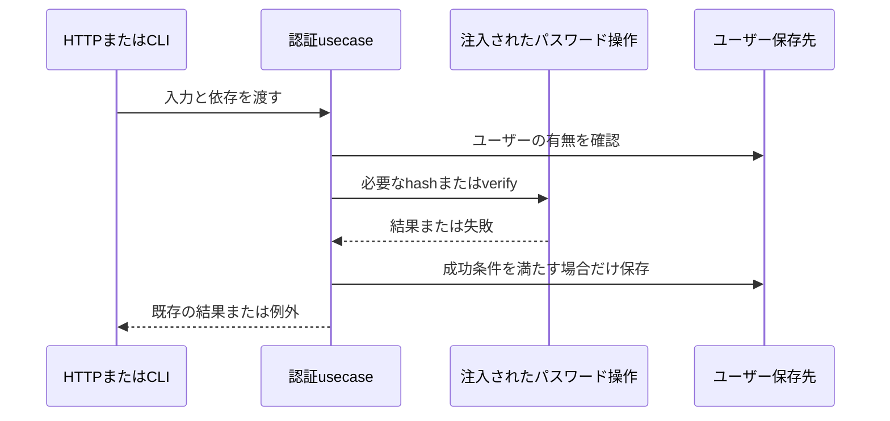

# API内部の依存方向を整理する計画

2026-10-27。既知課題R12のうち、申請の競合例外とパスワード操作の依存方向を対象とする。認証と申請の利用者向け動作は維持する。

## 調査と範囲

基点は`main`の`18ec68e`。fetch後の`origin/main`と一致し、既存変更はない。`domain/request/Request.ts`が`application/errors/StateConflictError.ts`を参照し、認証usecaseの`LoginUser`・`RegisterUser`・`ChangePassword`が`infrastructure/auth/password.ts`を直接参照している。既存の暗号処理と例外型を再利用し、別の暗号方式や重複した例外型は作らない。

競合例外をdomain内の共通エラーへ移す。HTTP固有のstatusCodeはドメインから外し、既存のHTTP変換側で409へ変換する。例外名・message・JSONのcode/statusを維持し、旧定義とすべてのimportを同じ変更で置き換える。

パスワード操作はapplicationの小さい契約でhash/verifyを受け取る。ログインはverify、ユーザー作成はhash、変更は両方を使う。usecaseからbcryptへの既定値・fallbackは持たせず、HTTPとCLIの組立で現在の実装を明示的に渡す。bcryptのラウンド数10、入力検証、保存、sessionVersion失効、cookie、権限、エラー形式は変更しない。既存HTTPテストでは本物のbcryptを引き続き使い、usecaseの呼び出し順序と失敗時の未保存をfakeで検証する。

DB・migration・依存追加・暗号方式変更・公開API変更・CI変更は対象外。domainのactor/team認可配置や画面分割も同時に変更しない。内部改修のため仕様書は新設せず、`docs/API.md`の認証・409契約を参照する。単体試験仕様と結果記録を作る。

## 責務と依存

- domainの競合例外: 業務状態・保存競合を表す。HTTPの知識を持たない。
- applicationのパスワード契約: usecaseが必要な非同期hash/verifyの入出力と失敗伝達を定める。暗号実装を持たない。
- infrastructureのbcrypt実装: 既存の暗号化・照合を担当する。applicationの契約を満たす。
- HTTP/CLI: 既存の暗号実装を業務処理へ渡し、失敗を既存の応答へ変換する。

ログインは保存しない。重複ユーザー・無効ユーザー・パスワード不一致・暗号処理失敗の各経路では、不必要なhash/verifyや保存が行われないことを試験で照合する。新規ソース・変更関数に役割と失敗契約を記載し、ステアリングの地図を更新する。

## 受け入れ条件と検証

| ID | 確認対象 | 方法 |
| --- | --- | --- |
| B1 | domainがapplication/infrastructureに依存せず、競合のHTTP 409と本文が維持される | import検索、既存状態遷移・保存version・HTTP試験 |
| B2 | 認証usecaseがbcrypt実装を参照せず、入力検証とhash/verifyの順序が維持される | 成功・不一致・存在なし・重複・依存失敗の単体試験 |
| B3 | 本物のbcryptでログイン・ユーザー作成・パスワード変更・旧認証失効が動く | 既存の本番HTTP＋架空メモリ保存先試験、CLI試験。DB接続なし |
| B4 | 品質基準と既存の利用者向け契約を維持する | Project Profileのformat・型検査・全テスト・API/Web本番build・secrets、自己レビューと独立レビュー |

既存lintは未整備でskipped。UIの変更がないため新たな見た目・ブラウザ試験は対象外。実DBは保存契約を変更せず、今回の試験はメモリ保存先に限定する。機密値は架空fixtureのみ。ログにパスワード・ハッシュを追加しない。新しい仮の調整値なし。

## PRとマージ

ユーザーの今回の指示により、通常PR作成・レビューとチェックの監視・問題がない場合のマージは承認済み。具体的な実装計画は提示後の「よいです」で承認された。計画承認後に専用branchで実装し、認証の依存変更を独立AIレビューする。

最終headに対するレビュー完了、未解決の有効な指摘なし、チェックの失敗・実行中なし、競合なしを確認してマージする。CI未設定はCI成功と区別し、ローカル検証を根拠として報告する。保護設定は迂回しない。指摘の修正後は影響する検証とレビューをやり直す。

rollbackは今回のcommitのrevertで、データ移行は不要。認証・公開API・DB仕様を変える必要が出たら再計画する。
