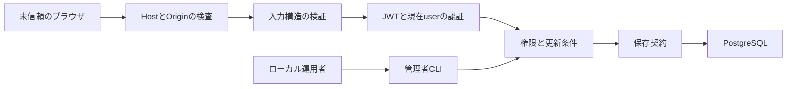
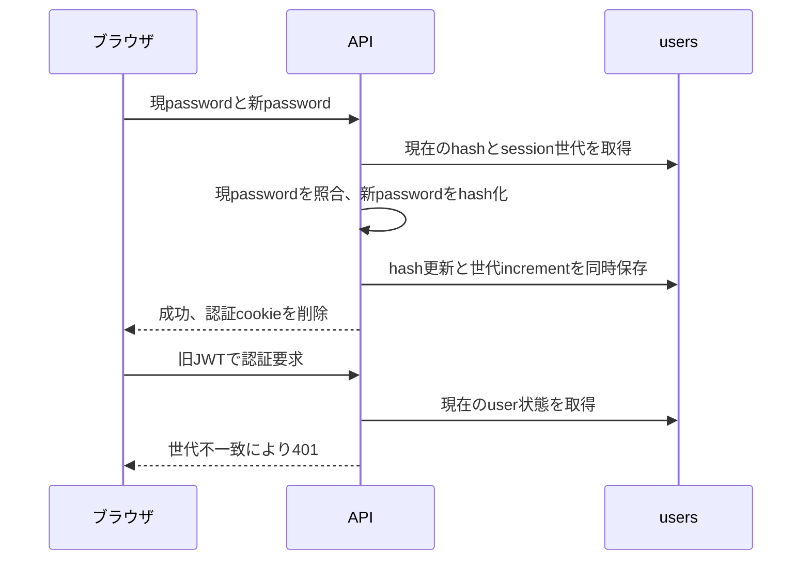

# 第2段階: 認証と入力境界の実装計画

Version 1 / 2026-10-26。基点main: `f51f287c96e9c7a3aed041b9fb1b4b310249b5c0`。
branch: `codex/auth-input-boundaries`。fetch後にorigin/mainと一致、開始時の作業ツリーはclean。
ユーザーの「進めてください」に基づき第2段階の調査・具体化を開始した。前段の計画に未決定と書かれた重要仕様は、この文書と [仕様案](spec-draft.md) にまとめて確認する。

## 要求と範囲

全体レビューR01/R02/R04/R05/R08/R14に対応する。
公開signupを廃止し、管理者によるユーザー作成・所属割当だけを残す。JWT鍵の必須化、セッション期限と失効、部分更新の保持、HTTP入力検証、ローカルserverのHost/Origin境界を扱う。
対象外は申請保存の楽観ロック、CSRF token方式の変更、一覧・画面の大規模分割、通知、LINE、多段承認、依存の追加、共有・本番DBへの適用。

## 仕様の根拠と確認

公開signup禁止とチーム割当の管理者制御は既存ステアリングの要件。PATCHの任意fieldは共有型に根拠がある。申請状態遷移・roleの意味は現行仕様を維持する。
初期管理者の作成方法、JWT期限、password変更後の失効は前段計画の候補であり、未承認の値を実装しない。
2026-10-26の会話で提示し、その後のユーザー「進めて」により承認された仕様: ローカルCLI、ログイン期限8時間、password変更時に現在のセッションも含め全失効。
DB変更を避けて全失効だけ後回しにする選択肢も示した。推奨案への承認を確認したため、sessionVersionのschema/migrationファイルと8時間期限を実装する。実DB適用は承認されていない。

## 変更箇所と責務

| 対象 | 役割と変更理由 | 依存・状態・I/O |
| --- | --- | --- |
| infrastructure/config/env.ts、main.ts | 起動設定を検証し、ローカルbindと許可Host/Originを明示 | process.envのみ。鍵の実値をログに出さない |
| presentation/httpの構築処理 | HTTP plugin/routeを組み立てる。テストは保存先だけ差し替える | DBの組立・切断は既存serverの外側に残す |
| HTTP schema/validationとroutes | 入力構造を実行時に検証し、許可fieldだけusecaseへ渡す | 既存Fastify/Ajvを利用、新validator依存は追加しない |
| application/authのvalidationとusecase | profile/role/languageの条件、未指定/null、password変更を扱う | PrismaやHTTPのschemaを業務型へ漏らさない |
| auth plugin・JWT/cookie処理 | tokenと現在userの状態から認証する | sessionVersion、期限、cookie寿命の所有者を明示 |
| User、UserRepository、PrismaUserRepository | session世代を永続化しpassword更新と同時に増やす案 | DB読取・書込。ユーザー一覧DTOへ内部世代を返さない |
| ローカル管理者CLI | DB権限のある運用者が管理者を作成する | 環境変数から入力、引数やログにpasswordを出さない |
| Webのpassword変更フロー | 全失効後に再ログインへ戻す | login状態とcsrfキャッシュを破棄。画面全体の再構成はしない |
| tests | 本番HTTPをFastify injectで呼び、保存先だけfakeへ置換 | 本物の鍵・DB・アカウントを使わない |

既存の同等処理はRegisterUser/UpdateUser/UpdateAccountの正規化、validateEmail/validatePassword、authCookieOptions、requireAuthを確認した。profileの同じ条件はauth内に集約し、routeごとに新しい独自validatorを複製しない。
公開register route、clientのregister関数と未参照AuthPanelの登録導線は削除する。古いAPI契約はdocs/API.mdとopenapi.yamlを更新し、生成型と共有型を照合する。
初期AdminのCLIは新しい公開endpointではない。既存emailを昇格・上書きせず、重複は安全なエラーにする。実際のアカウント作成は今回のコード実装とは別操作。

## 信頼境界と状態

第2図は全失効案を選ぶ場合の設計。期限なし・世代なしの旧JWTも拒否するため、切り替え後に再ログインが必要。

## 検証と受け入れ

受け入れ条件は仕様案AC1〜AC9、対応ケースは [試験案](tests-draft.md) を正本とする。
実装前にdocs/API.mdへ仕様を統合し、機能/単体試験仕様へケースを配置する。仕様の二重管理を残さない。
HTTP/CORS/チーム境界の既存文字列検査を実リクエストの成功・拒否へ置換する。認証なし、別team、Applicant、Approver、Admin、自己操作、入力の型違い、null/未指定、期限切れ、旧世代tokenを確認する。
Host/Origin/cookieの正常系は実ブラウザでも確認する。機密データのないfixture serverを使い、共有DBと本物のユーザーを使わない。利用できない環境は未実施と明記する。
通常の型検査・全テスト・build・Harness Runner・秘密検査を実行する。認可/API/schema変更のため、自己レビューに加え独立レビューを実施する。

## DBと秘密

全失効案ならusersにsessionVersion INTEGER NOT NULL DEFAULT 0を追加するmigrationファイルを作成する。既存データの削除・passwordの変更は含めない。
Prisma Clientの生成はコード生成として実施する。実DBへのmigration適用・管理者作成・既存.envの読取は行わない。
schema適用を試験する場合は、隔離DBの場所・寿命・操作範囲を具体化して別途承認を得る。既存DBのデータ量とlock時間は未確認であり、共有DBへ適用可能と断言しない。
password/JWT/接続文字列は実行環境から渡す。テストは架空値を使い、ログ・APIのerror・PR本文へ実値を残さない。

## リスクとrollback

公開register廃止は破壊的なAPI変更だが、MVPのsignup禁止要件を満たすために必要。旧tokenは失効する。入力の型・UUID・列挙値が不正な要求は、従来の500等から400へ変わる。
rollbackはコードcommitのrevertを基本とし、追加したDB列は無害な状態で保持する案とする。列をDROPする操作は別承認。旧tokenの無制限な再許可をrollback手順にしない。
新しい長さ上限、Unicode正規化、パスワード規則、Adminの管理範囲、申請状態遷移は変更しない。

## 現在の状態

仕様の正本はdocs/API.md、試験仕様はdocs/tests/functional・unitへ統合した。実装と検証を進行中。migrationの実DB適用と実ユーザー作成は行わない。

2026-10-26の追加確認で、ユーザーは「通常PRまで作成する」を選択した。実装・検証・独立レビュー後のpush/通常PR作成まで承認済み。実DB適用は行わない。
