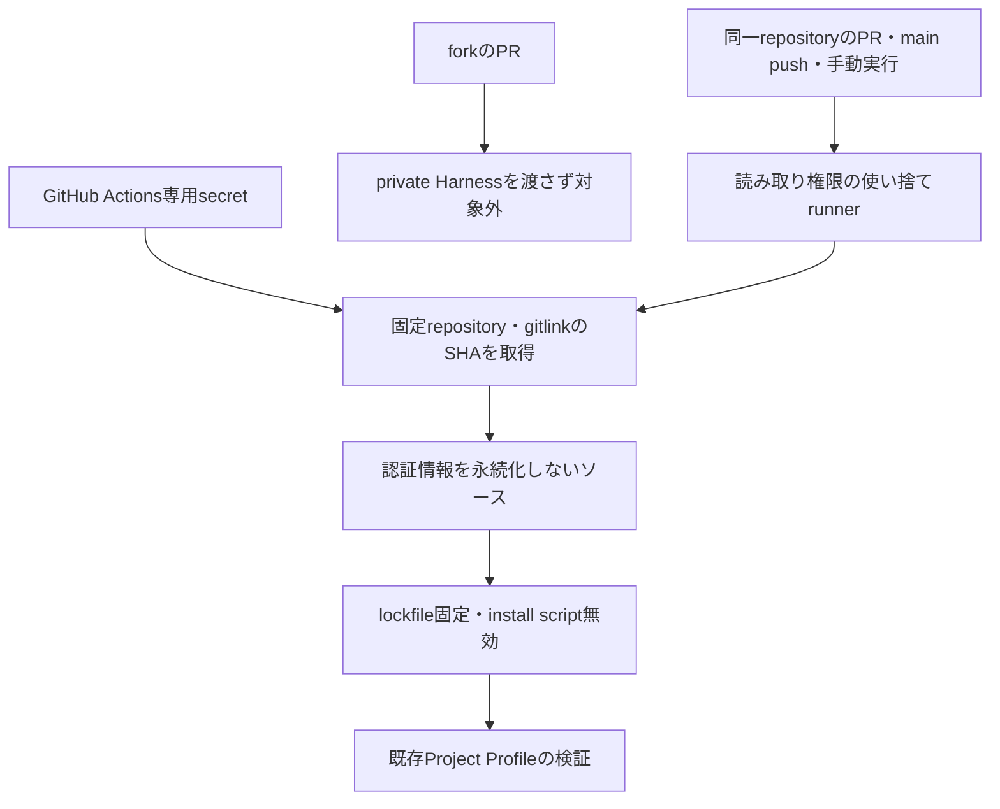

# CIで既存の検証を再現する計画

- 状態: 2026-11-04、会話で「よいです」を受領し、案AのCI・専用参照権限・外部Actionの追加が承認された。実装と検証を進める。
- 目的: PRを監視するときに、ローカル検証だけに依存せずGitHub上で検証結果を確認できるようにする。
- 要求の出典: 全体レビューのCI未整備の指摘と、「pr作ったら監視して問題なければマージして引き続き開発を進めてください」という会話。
- 仕様: [ci-validation.md](../../specs/ci-validation.md)。試験: [機能](../../tests/functional/ci-validation.md)・[単体](../../tests/unit/ci-harness-ref.md)。草案から移動した。
- Git: PR #19をマージ後、mainを56b7c0256d81c30835e0269f5805d0d349619a91へfast-forwardした。origin/mainと一致し、作業ツリーはclean。次の計画をcodex/ci-validation-planへ分けた。

## 調査結果

PR #19のhead 1827e87に対するCodex自動コードレビューは完了し、指摘なしだった。行単位のコメントもなく、mergeableはMERGEABLEだった。GitHubのチェック一覧は空で、`gh pr checks 19`は`no checks reported`を返した。ローカル検証の347件の試験・型検査・本番build・書式・秘密情報検査の成功とは区別している。

PR #19は2026-11-04T01:37:55Zにsquash mergeされた。マージコミットは上記mainのrevision。[PR](https://github.com/Czmirror/MiniFlow/pull/19)と[自動レビュー](https://github.com/Czmirror/MiniFlow/pull/19#issuecomment-6611032594)を参照する。ブラウザ機能試験は未検証のままで、CI未設定・ブラウザ未実施の既知の限界をPR本文に明記している。

共通Harnessのsubmoduleは`git@github.com:Czmirror/ai-dev-context.git`、固定参照はeea51edcd728d32a9ef1e943ec1b64fd9477cac3である。GitHubのリポジトリ情報でPRIVATEを確認した。MiniFlowのrepository secretsの名前一覧は空だった。secretの値は読んでいない。通常のMiniFlow用GITHUB_TOKENだけで、別のprivate repositoryを取得できると仮定しない。

## 選択肢と推奨案

推奨案Aは、Harnessだけを読める専用の認証情報をMiniFlowのGitHub Actions secret `HARNESS_READ_TOKEN`に設定し、明示したrepositoryの固定revisionを取得する方式。fine-grained tokenを使う場合は、対象repositoryをai-dev-context、権限をContents: readと自動付与のMetadata: readに限る。期限・発行主体は運用者が決める。既存の個人用tokenの権限を広げたり、その値をチャットに渡したりしない。

代替案Bは、GitHub App等から短命のread-only tokenを発行する方式。長期credentialを避けられるが、Appの作成・インストール・秘密鍵の管理が追加で必要になるため、今回は導入しない案を推奨する。

代替案Cは、CIを保留して他のアプリ改善の計画へ進むこと。Harnessを公開にする、既存credentialを流用する、共通ルールを複製して正本を二重にする、という回避は行わない。

## 変更予定と実行順

1. `.github/workflows/validation.yml`を追加する。mainへのpush、同一repository内のPR、手動実行を対象とする。forkのPRではprivate Harnessも専用認証情報も渡さず、検証対象外であることを明示する。
2. `actions/checkout`を使いMiniFlowを取得する。submoduleの自動取得はせず、`persist-credentials: false`とする。
3. `.harness/upstream`のgitlinkを`git ls-tree`で読み、modeが160000でrevisionが40桁のSHAであることを検証する。`.gitmodules`の任意URLを認証情報付きで取得しない。
4. 取得先を`Czmirror/ai-dev-context`に固定した別のcheckoutで、gitlinkと同じrevisionを`.harness/upstream`へ置く。専用secretはこの取得stepだけに渡し、永続化しない。secretが未設定ならキー名だけを案内して失敗させる。
5. `actions/setup-node`でNode.js 22系、CorepackでpackageManager指定のpnpm 10.6.3を準備する。外部Actionは承認後に公式repositoryで出典を確認し、40桁SHAで固定する。候補は共通HarnessのCI雛形にあるcheckoutとsetup-nodeのみで、新しいinstaller Actionは足さない。
6. `pnpm install --frozen-lockfile --ignore-scripts`、`pnpm db:generate`で必要な生成物を準備する。installの任意のlifecycle scriptは実行しない。Prisma Clientの明示生成のみ許可する。
7. `node .harness/upstream/scripts/validate-config.mjs`、`node .harness/upstream/scripts/validate.mjs --execute`を実行する。ローカルと同じProject Profileを使う。
8. READMEとrunbookにCIの対象・private Harnessの設定先・未検証範囲を記載する。公開デモ、DB、認証、API、ブラウザ機能は変更しない。

jobは`permissions: contents: read`、`timeout-minutes: 20`とする。cache、artifactのupload、定期実行、deploy、自動修正、自動commitは導入しない。Next.js telemetryを無効にする。DBサービスは起動せず、Prismaが接続設定の形式を必要とする場合だけ、実在しないloopbackの架空接続先を与える。実DB・migrationは使わない。

## 信頼境界

同一repositoryへbranchを書ける人のコードだけを、private Harnessを置くjobで実行する。この信頼範囲を受け入れられない場合は、PRの自動検証をmain上の手動承認方式へ変更して再計画する。PRのtitle・body・branch名をshellへ直接埋め込まない。`pull_request_target`は使わない。

## 承認対象の副作用

- 外部Action追加: GitHubのactions/checkoutとactions/setup-nodeの固定SHA版をGitHub-hosted runnerで実行する。
- 外部通信: GitHubからソース・Action、package registryからlockfileの依存・pnpm、必要に応じPrismaの配布元からengine binaryを取得する。アプリの入力データや既存の秘密値は送らない。
- 参照権限: private Harnessを読む専用の権限を新設する。値はGitHubの安全な設定先だけに入力し、チャット・TickTick・Gitへ残さない。設定が必要な場合のユーザー作業は、計画承認後にTickTickの既存タスクと照合して登録する。
- 実行料金: GitHub Actionsの利用枠を消費する。残高・上限は未確認。定期実行や有料runnerは設定しない。

## 検証とレビュー

- K1: ローカルとCIが同じProfileを実行することを差分で照合し、PR上の結果を確認する。
- K2: Actionの固定SHA、読み取り権限、credential非永続化、fork除外、secretなしの安全な失敗を確認する。
- K3: クリーンrunnerで依存準備・Prisma生成・347件以上の既存テスト・型検査・buildを実行する。新しい失敗は原因を調査し、既存試験をskipして成功させない。
- CI変更は共通workflowの独立レビュー必須条件に当たるため、承認後の実装差分を別reviewerに読み取りのみで確認してもらう。
- lint、ブラウザE2E、依存脆弱性監査は別の未整備項目として残す。CI導入の成功でこれらまで検証済みとは扱わない。
- 見込み時間: workflow実行は20分で打ち切る。実時間は初回のクリーン実行で測定する。

## rollbackと実装開始条件

導入後のrollbackは追加workflowの停止と、専用参照権限の失効で行う。アプリとDBのrollbackは不要。branch保護・merge制限はこの変更で操作しない。

実装承認の出典は、本計画と追加する権限・Actionの説明への会話上の「よいです」。PR作成・監視・問題がない場合のマージは、先行する継続開発の依頼の範囲として扱う。参照tokenの発行・期限決定・安全な設定先への入力は運用者が行う。値を代理で取得したり、既存credentialを流用したりしない。

## 実装時に具体化した事項

- 再開時もfetch成功、基点mainは56b7c02でorigin/mainと一致した。既存変更は本計画の未追跡文書だけ。
- `HARNESS_READ_TOKEN`の設定名一覧を再確認したところ未設定だった。ユーザー作業は重複確認後、[TickTick](https://ticktick.com/webapp/#p/inbox120612365/tasks/6aeac53f8f0849d664c19dc3)へ登録した。期限・通知・繰り返しは設定していない。
- `.github/scripts/harness-ref.mjs`は固定pathのgitlink検証とSHAのAction出力だけを担当する。CLIはNode標準ライブラリだけを使い、gitを引数配列で実行する。秘密の入力は受け取らない。
- `.github/scripts/harness-ref.d.mts`は同helperをTypeScript試験から呼ぶ契約で、実装の正本はmjsとする。`tests/ci/HarnessRef.spec.ts`は本番helperに対し、不正mode・型・SHA・path・追加行を検証する。workflowにはgitlinkの形式検証を重複実装しない。
- workflowの認証設定確認には、secret自体ではなく式の真偽値だけを渡す。専用secretの値は固定repositoryのcheckoutだけに渡す。
- checkout v7.0.1のSHAは3d3c42e5aac5ba805825da76410c181273ba90b1、setup-node v7.0.0は820762786026740c76f36085b0efc47a31fe5020。2026-11-04に公式GitHub APIでtagとSHAの一致を確認した。Actionの入力定義を公式の固定revisionで確認した。ライセンスは個別出典で確認し、Action自体はアプリへ同梱しない。
- 出典: [checkout入力](https://github.com/actions/checkout/blob/3d3c42e5aac5ba805825da76410c181273ba90b1/action.yml)、[setup-node入力](https://github.com/actions/setup-node/blob/820762786026740c76f36085b0efc47a31fe5020/action.yml)。両Actionの同revisionのLICENSEはMIT。導入はソースのコピーではなくrunnerでの実行に限る。既知の脆弱性の網羅的監査とAction内部の全間接依存の監査は未実施。
- 同等処理の検索は既存workflowと共通HarnessのCI雛形、package scriptsを対象に実施した。既存のMiniFlow workflowはなく、雛形を使って同じProfileを呼ぶ。共通Harnessを複製・編集しない。
