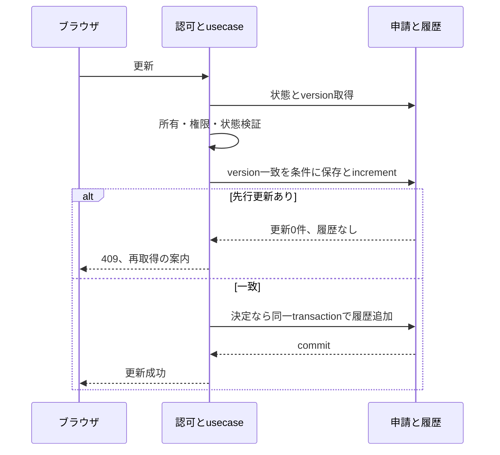
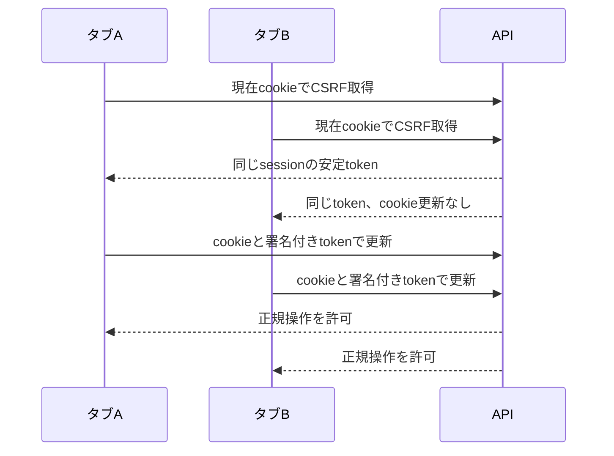

# 第3段階: 申請保存の競合・CSRF・安全なイベント記録

Version 1 / 2026-10-26。状態: 2026-10-26の会話で仕様・隔離DB・独立レビュー・通常PRまで提示し、ユーザーの「ok」により承認。実装中。
基点: main `d658dbb78b8b64ffd0b24b4e19133866fdb658c4`（PR #5マージ済み）。開始時clean、fetch後mainをfast-forwardし、branch `codex/concurrency-csrf` を作成した。
要求は全体レビューR03/R07/R13の解消。上位の段階計画は [全体計画](../harness-source-review/plan.md)。
仕様は [API](../../API.md#第3段階-競合とcsrf)、試験は [機能試験](../../tests/functional/concurrency-csrf.md) と [単体試験](../../tests/unit/concurrency-csrf.md) に統合済み。作業内の旧草案は案内のみ。

## 調査と変更範囲

PrismaRequestRepository.update/persistDecisionはidだけで保存し、後者だけtransactionを使う。Requestに保存世代はない。approve/reject以外のedit/submit/revise/deleteも古い取得状態で上書きできる。
authのGET /auth/csrfは取得ごとにcookieを変え、requireCsrfはcookie/headerの一致だけを見る。Webはtokenを長期cacheする。これは複数タブ・並行取得と相性が悪い。
前段のJWT期限・全失効・401復帰・Host/Origin検証は維持する。申請状態遷移・role/teamの業務条件は変えない。
対象外: 一覧/集計・全体UI分割、password更新の競合、共有DBへの適用、実アカウント、通知/LINE/多段承認、依存追加、永続監査基盤。

## 提案と選択肢

| 判断 | 推奨案と影響 | 代替案 |
| --- | --- | --- |
| 競合時 | 先に保存した操作だけ成功、後発へ409。自動再試行せず再取得を案内 | 自動再試行は利用者が見ていない状態への更新になり得る |
| 鮮度の範囲 | サーバーが取得してから保存する間の競合をversion条件で防ぐ。DTOにversionを追加しない | 画面表示時点からの古さも防ぐなら公開version/If-Matchが必要。今回は次段階へ残す |
| CSRF | ログインごとの乱数識別子をJWTへ署名し、そのsessionに結び付くHMAC tokenを発行。同じsessionでは安定 | サーバー保管型はsession保存テーブルと運用が増える |
| Webのtoken取得 | 更新要求の前に現在のtokenを取得。同時取得だけPromiseを共有し、長期cacheを廃止 | 長期cache維持は別タブ再login時の古さを別の同期機構で扱う必要がある |
| 監査 | 保存成功後の業務イベント・拒否・障害を既存loggerの安全なfieldだけで記録 | 消失しない監査台帳にはDB/outbox等の別設計が必要 |

HMACにはJWT鍵から用途を区別した入力を使い、比較は定時間で行う。新しい独自暗号方式は作らずNode標準cryptoを使用する。ログイン時だけCSRF cookieを設定し、GET取得でcookieを更新しない。JWTに新しいsession識別子がない旧形式は再ログインを要求する。認証の8時間期限は変えない。

## 責務・I/O・置き換え

| 箇所 | 役割、所有する状態と変更 |
| --- | --- |
| domain/request/Request.ts | 取得した保存versionを引き継ぐ。業務遷移は現行のまま |
| application/ports/RequestRepository.ts | 取得versionと一致するときだけ保存し、競合は既存StateConflictErrorで返す契約 |
| infrastructure/repositories/PrismaRequestRepository.ts | 全申請更新でversion一致条件とincrement。決定履歴を同じtransactionに保存 |
| prisma/schema・migration | requestsへversion列を追加。既存行の初期値0、削除なし |
| infrastructure/auth/csrf.ts | sessionに結び付けたtokenの生成・検証。既存createCsrfTokenと比較処理を置換 |
| HTTP auth plugin/routes | JWT session識別子の受渡し、cookie発行、CSRF拒否。既存Host/Origin検証を再利用 |
| Web apiTransport.ts | 更新前の取得と同時取得の共有。旧長期cacheを削除し、認証変更時に未完了取得を無効化 |
| HTTP routesとイベント用helper | 保存結果・actor/action/resource/correlationだけ記録。例外や入力全文は渡さない |
| tests/supportとtests | 保存先だけfake。domain/HTTP/保存契約は本番import。実DB試験は別の明示起動 |

同等処理は既存StateConflictError、requireAuth/requireCsrf、csrfHeaders、authCookieOptions、Prismaの決定transactionを再利用する。ORM固有型はdomainへ入れない。無関係なUI分割は行わない。新しいhelper・公開契約には役割・単位・寿命・失敗を説明し、削除対象の旧cache/parserが残らないことを検索する。

## 適用ルールと証拠

Database/SQL → AC1/AC2 → 全更新の条件付き保存と実PostgreSQLの競合・rollback。
Security/Input validation → AC3/AC4 → session不一致/改ざん/欠落/別Origin拒否と複数タブのブラウザ試験。
Logging/Sensitive data → AC5 → logger捕捉でallowlistと秘密・個人情報・自由入力の不出力。
Principles/Comments/Design → 変更責務表 → 最終差分で旧実装削除、内部versionの所有、token寿命・失敗契約を確認。
Quality → AC1〜AC6 → 既存189件を含む型検査/test/build/format/secrets、独立AIレビュー。lintは既存未整備のまま。

## 隔離DB試験の操作承認対象

Docker稼働と既存の `postgres:16-alpine` / `postgres:17-alpine` を読み取り確認済み。sandbox内からsocketを読めず、読み取りの権限拡張で確認した。DB/コンテナは未作成。
推奨: 既存postgres:16-alpineを使い、今回だけのコンテナ `miniflow-stage3-test-<乱数>` とDB `miniflow_stage3_test` を新規作成する。既存volumeをmountせず、専用tmpfsにデータを置き、portは127.0.0.1の空きportだけ公開。privileged/ホストnetworkを使わない。
許可対象はその新規コンテナとDBのみ。架空データ1000件未満、schema作成・全migration適用・INSERT/UPDATE/SELECT・試験失敗時の再作成を含む。使い捨てのテスト資格情報だけを使い、既存.envや実DBの資格情報を読まない。新規imageのpull/installは含めない。
寿命は今回の実装・検証session中。完了/中断時に今回作成したコンテナだけ停止・削除し、tmpfsの架空データを破棄する。既存コンテナ/DB/volume/imageは変更・削除しない。
初期状態は空、既存データの損失/停止はない。migration lockはこの専用DBだけで測り、共有DBへ適用可能とは保証しない。復旧は専用DBを再作成して再試験する。
この操作が許可されない/環境で実行できない場合は実DB検証を未実施として残し、完了扱いにしない。

## リスク・rollback・状態

requestsの列追加後に新コードを使う必要がある。共有DBへの適用は今回の承認に含めない。前段users列のmigrationも専用DB内でのみ適用する。
コードのrollbackはcommit revertを基本とし、実環境の列DROPや旧tokenの再許可は自動で行わない。運用上の永続監査、古い画面全体の検出、実DBの既存破損データ修復は対象外として記録する。
計画と上表の重要仕様、専用DB操作の承認後に実装する。実装・全検証・独立レビュー後、具体的な差分で通常PRへまとめる。新しい依存、業務遷移、共有DB操作が必要になれば範囲を再確認する。

## 承認済み実装の補足

ホストの高負荷で既存testもtimeoutしたため、fixtureの固定passwordのhashをプロセス内で再利用した。保存先とuserは各試験で独立し、本番hash設定・test timeout・Harness品質基準は変更しない。診断時のCLI timeout拡張結果は標準Runnerの成功と区別する。
独立レビューの重複error指摘に従い、操作失敗は応答完了イベントへ一本化した。未登録GET等の500も固定actionで記録し、障害ログを失わない。
