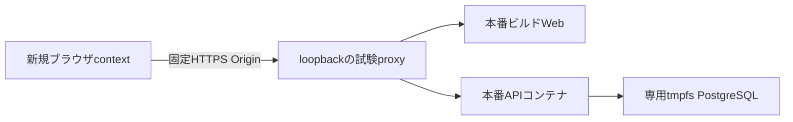

# 本番コンテナで承認フローをE2E検証する

2026-11-23の会話「問題なければマージして、引き続きe2e」を受け、PR #26のCI・レビュー・未解決threadなしを確認しマージした。基点はfetch済みmain `ccc272e`。別worktreeで既存ホームページ作業を保護する。

今回の受け入れ条件は、[既存API仕様](../../API.md)の申請・差し戻し・修正・再提出・承認、チーム分離、永続化が本番API imageでも成立すること。機能仕様の変更は行わず、実装は試験入口・自動操作と記録だけに絞る。

1. 専用ComposeでtmpfsのPostgreSQL16と本番API imageを起動する。対象はminiflow_container_test、hostの55449番のみ。既存DBや.envは使用しない。9件の既存migrationを専用DBへ適用し、架空4ユーザーだけを投入する。終了時は専用Composeだけをdownする。
2. Webを本番build/startし、Nodeの固定loopback proxyで同一HTTPS Originへ接続する。自己署名の使い捨て証明書は/tmpだけに生成する。Playwright 1.65.1を一時tools directoryへ導入し、既存Chromeを新規profileで使う。repositoryの依存・CIは変更しない。
3. 画面から作成→提出→理由付き差し戻し→修正保存→再提出→同じ承認者で承認する。別チームの非表示、Secure/HttpOnly/SameSite属性、CSRFなし拒否、logout、API再起動後の保持も確認する。
4. SQL/ORMでApproved・version・判断履歴を照合し、スクリーンショットと結果を残す。全体Profileと独立レビュー後に通常PRへまとめ、新規PRはマージしない。

Database/Safety→対象DB・tmpfs・loopbackを固定し、共有DBの読み書きを行わない。Sensitive data→既存の架空fixtureを再利用し、token/cookie値はログや画像へ出さない。Quality→ブラウザと実DBの結果を別々に確認する。既存の手動メモリ試験はDBなしのUI確認用として残す。

自己署名証明書の検証を無視する設定は、固定のlocalhost専用の新規ブラウザcontextだけに限定する。公開証明書の信頼・DNS・配信先の安全性を証明したとは扱わない。OS/ユーザーの証明書設定は変更しない。外部URLへのアクセスや本物のユーザー情報は使わない。

composeは試験インフラ、seedは空の固定DBの初期化、proxyはHTTPS→loopbackの転送、browser scriptは画面操作を担当する。applicationの業務処理を複製しない。既存seedTestUsersと本番Dockerfileを再利用する。単体試験は形式的な複製になるため追加しない。機能試験の記録を作る。

検証の穴: このE2Eは標準CIに含めない。lint・依存脆弱性監査は未整備。実公開先のTLS/Cookieは別途確認が必要。失敗時は原因を修正し影響範囲を再実行し、失敗を成功として扱わない。

FT1〜FT5がブラウザからAPIまで、FT6が保存結果を確認する。証明書検証の例外はブラウザcontextとlocalhostの限定経路だけに置き、配信物・本番設定の既定を緩めない。
