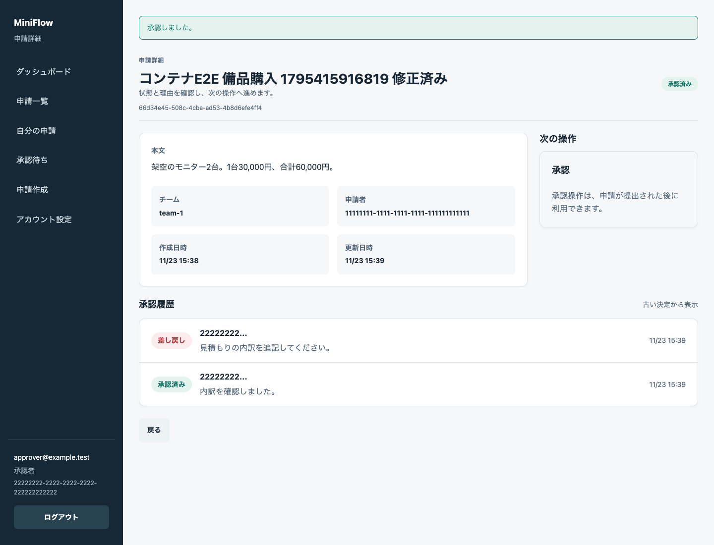

# 本番コンテナのE2E検証結果

本番APIコンテナと実PostgreSQLを使い、画面から承認フローを自動検証した。公開前のつながりを確かめるため、Webも本番ビルドを使った。公開配信先と信頼済み証明書の確認は未実施である。

## 確認結果

2026-11-23、AIによるPlaywright 1.65.1 / Chrome 157.0.8103.80の新規profileで実施。基点はPR #26マージ後の`ccc272e`。既存のホームページ作業は含めず、本番の業務処理・認証契約は変更していない。

[機能試験FT1〜FT6](../../tests/functional/container-workflow-e2e.md)は全件成功した。ブラウザの9確認項目は[evidence.json](evidence.json)に保存した。

- ログイン後のCookieはSecure・SameSite=Lax、認証CookieはHttpOnly。CSRFなしのブラウザ更新は403で拒否された。
- 作成→提出→理由付き差し戻し→下書きへ戻す→修正保存→再提出→同じ承認者で承認が成功した。
- 別チームでは一覧が空になり、対象IDの詳細APIも403で拒否された。
- API再起動後もauth/meは200、画面で承認済み状態と判断履歴が保持された。logout後はログイン画面となり認証Cookieも削除された。
- SQLでApproved・version 7・判断履歴2件・承認者1人を確認した。users 4・requests 1・approvals 2で、既存DBは使っていない。seed再実行は初期化済みとして拒否され件数を維持した。

意図したHTTPエラーは匿名起動の401が3件、CSRF/別チーム拒否の403が2件。これに対応するconsole errorが5件で、想定外HTTP/console errorとpageerrorは0件。APIログにもCSRF拒否に対応する警告が1件あり、障害ログはなかった。



画像は自作MiniFlowの架空データの試験画面をPlaywrightで取得したもの。1440×1100 PNGで、縮小・加工なし。外部画像の転載はない。実ユーザー情報・Cookie・tokenは含まない。repository自体の再利用ライセンスは未設定で、別用途への再配布条件は決めていない。

## 失敗の調査と再検証

初回はAPI再起動後の画面復帰で失敗した。切り分けでは、本人情報APIは200を返し、その後に画面がログイン中からダッシュボードへ復帰することを確認した。文書のreload完了だけでなくReactの本人情報取得を明示的に待ち、200を照合してから画面を確認するよう試験を修正した。画面assertionのtimeoutを増やしたり、本番コードを緩めたりはしていない。

専用DBを再作成し、migration/seedから全経路を再実行して9項目すべて成功した。最終SQL照合も空からの1件の申請に対して行った。最初のPlaywright導入は空のnpm設定の指定方法で止まり、別々の空設定ファイルを使って導入した。repositoryのpackage.json・lockfileは変更していない。

## 再実行手順

Docker・Node 22.12以上・pnpm 10.6.3・Chromeを用意し、通常の依存installとPrisma Client生成を済ませる。以下は専用の使い捨てDBだけを作成・変更・破棄する。固定port 43150〜43152と55449が空いていることを確認する。既存の.envは読み込ませない。

1. 外部ツールを隔離する。PlaywrightはMicrosoftのApache-2.0のpackageをnpm公式registryから取得し、lifecycle script・audit・fundを停止する。既存のChromeを使い、追加のブラウザbinaryは取得しない。

```sh
mkdir -p /tmp/miniflow-e2e-tools
npm install --prefix /tmp/miniflow-e2e-tools --registry=https://registry.npmjs.org \
  --ignore-scripts --no-audit --no-fund playwright@1.65.1
```

2. 専用DBと本番API imageを起動し、既存migrationを専用DBへ適用する。初期ユーザーは空DBにだけ投入できる。

```sh
docker compose -p miniflow-container-e2e -f tests/integration/container.compose.yml up -d --build
DATABASE_URL=postgresql://miniflow_container_test@127.0.0.1:55449/miniflow_container_test \
  pnpm --filter @miniflow/api exec prisma migrate deploy
pnpm exec vite-node tests/support/containerSeed.ts
```

3. 試験用の自己署名証明書を一時directoryへ生成する。OSの証明書・ブラウザの個人設定を変えない。

```sh
mkdir -p /tmp/miniflow-e2e-tls
openssl req -x509 -newkey rsa:2048 -sha256 -nodes \
  -keyout /tmp/miniflow-e2e-tls/key.pem -out /tmp/miniflow-e2e-tls/cert.pem \
  -days 1 -subj '/CN=localhost'
```

4. Webをbuild後にstartし、別terminalでHTTPS proxyを起動する。試験中に別のWeb buildを実行しない。

```sh
NEXT_TELEMETRY_DISABLED=1 NEXT_PUBLIC_API_BASE_URL=https://localhost:43150/api \
  pnpm --filter @miniflow/web build
pnpm --filter @miniflow/web exec next start --hostname 127.0.0.1 --port 43152
```

```sh
node tests/support/containerProxy.mjs /tmp/miniflow-e2e-tls
```

5. ブラウザの自動操作を実行する。途中で専用APIだけを再起動する。画面画像と値を秘匿した結果JSONを出力する。失敗した場合も画面・API・DBを切り分け、原因を調べてから新しい空DBでやり直す。

```sh
node tests/e2e/containerWorkflow.mjs /tmp/miniflow-e2e-tools /tmp/miniflow-container-e2e-results
```

6. SQLで保存を照合する。固定queryでschema・保存世代・履歴件数を確認する。

```sh
docker compose -p miniflow-container-e2e -f tests/integration/container.compose.yml exec -T db \
  psql -U miniflow_container_test -d miniflow_container_test -c \
  'SELECT r.status, r.version, count(a.id) AS decisions, count(DISTINCT a."actedBy") AS actors FROM requests r LEFT JOIN approvals a ON a."requestId"=r.id GROUP BY r.id,r.status,r.version;'
```

7. Web/proxyのterminalをCtrl+Cで停止し、専用Composeをdownする。DBはtmpfsで、次の作成時には空になる。

```sh
docker compose -p miniflow-container-e2e -f tests/integration/container.compose.yml down
```

今回の試験用Web/proxy・API/DBコンテナはすべて停止済み。既存DB・他のコンテナには触れていない。

## 全体検証と残課題

Harness Profileの書式・型検査・31ファイル392テスト・本番build・秘密情報の限定パターン検査も成功した。E2E用JavaScriptはNodeの構文検査と実行で確認した。単体試験で業務処理を複製していない。DB migrationの新規作成、アプリの仕様変更、project依存・CI変更はない。

自己レビューでは、固定DB/port、空DB以外のseed拒否、proxyのHost制限、ブラウザの固定Origin以外の通信拒否、Cookie値を保存しないことを確認した。独立AIレビュー（`ccc272e`→`0cb89d4`）は指摘なし。Security・Data・Tests・Docs and commentsの観点で固定DB/port・空DB以外の拒否・通信の限定・秘密を含まない証拠・責務分離を照合した。JavaScriptの構文検査は独立に成功し、実DB/E2E/全体検証の独立再実行は行っていない。人間による受け入れは未実施。

この自己署名証明書の例外は固定localhost専用の新規contextだけであり、実公開先の証明書・DNS・TLS設定を確認した意味ではない。標準CIへE2Eはまだ含めていない。管理者画面、英語全画面、複数ブラウザ、ログイン試行制限・共有デモの改変/データ初期化対策は引き続き残る。

範囲外の表示課題: 承認済みの「次の操作」に、提出後に操作可能という案内が残る（RequestDetailActions.approvalUnavailableMessage）。権限と処理は正しいが文言が紛らわしい。今回の画像で記録し、E2Eの範囲を広げず未修正とした。

次はアクセスを制限した配信先を整え、信頼済み証明書でこの承認フローを確認する。状態はHumanReview待ち。
