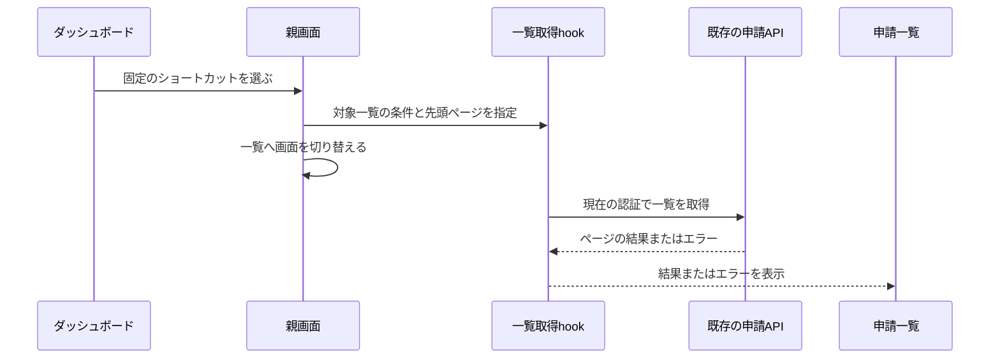

# ダッシュボードの数字から、見たい申請へそのまま進む

## 今回の改善

今のダッシュボードは件数を確認する画面になっている。たとえば「差し戻しが3件ある」と分かっても、一覧を開き、差し戻しを選び直さないと内容を見られない。件数カードを入口にして、この一手間を減らす。

カードの下に「差し戻しの申請を見る」のような行き先を添える。カード全体を押せるようにし、hoverとfocusでも操作できることを伝える。承認待ちの抜粋には「すべて見る」を加える。見た目は既存の色・余白・角丸を使い、既定の水準Bを採用する。新しい外部デザインサービスや素材は不要。仮の調整値は予定しない。

## 選んでいただく仕様

数字はこれまでどおりチーム全体の集計を基本とする。「自分の申請」だけ本人の一覧を開く。状態のカードはチームの申請一覧へ進む。一方、抜粋の「すべて見る」は自分が承認するための既存一覧へ進む。この違いを補助文に示す。

ショートカットは、押したカードの条件で必ず1ページ目から開く案を推奨する。以前の絞り込みを引き継ぐ案もあるが、数字と開いた一覧が食い違うため採用しない。サイドバーからの通常の移動は、これまでどおり位置を復元する。ほかの一覧の位置は書き換えない。0件のカードも開けるようにし、一覧側の空表示を使う。

仕様は`docs/specs/dashboard-shortcuts.md`のDS1〜DS5。機能試験は`docs/tests/functional/dashboard-shortcuts.md`のDF1〜DF5、単体試験は`docs/tests/unit/dashboard-shortcuts.md`のDU1〜DU4。計画・仕様・試験をまとめて承認対象にする。API・DB・権限・依存・検索は変更しない。

## 調査と作り方

2026-10-29、作業rootはMiniFlow。変更なしの`main`から調査し、fetch後のlocal/`origin/main`はともに`95f5785c2df74f2f8cf652a64eaf768c99fef6e9`。取り込みは不要。branchは承認後に`codex/dashboard-shortcuts`を使う。

既存の`Dashboard`は6つの件数を操作できない`Metric`として表示する。承認待ちの表は5件までの抜粋。`requestListSelection.ts`は一覧ごとの位置・状態を持つが、既存の状態変更は同値なら位置を変えないため、今回の「指定した一覧を先頭から開く」操作は別の意図として追加する。`useRequestCollection.ts`の取得・401処理・旧応答の拒否を再利用し、別の取得処理は作らない。過去の全体レビューR06/R11と、現在のページ送り・言語分離・未保存確認の実装を照合した。

- Dashboardの表示は既存の部品に保ち、カードの補助文・ボタン・一覧への操作callbackを追加する。集計や通信は持たせない。
- カードから一覧への固定対応は小さい専用の純粋な処理にまとめる。画面表示用の文言や通信は持たせず、未知の指定は返さない。既存のstatus型を再利用する。
- 一覧位置の状態処理へ対象一覧・状態・先頭ページをまとめて指定する操作を追加する。認証境界と位置の寿命は既存どおりとする。旧操作を残すのは通常の状態変更と意味が異なるため。
- 取得hookは上記操作を公開し、親画面は一覧指定と画面切替を接続する。親へカードの条件表や別の通信状態を増やさない。

主な変更対象は`MiniFlowApp.tsx`のDashboard/Metricと接続、`requestListSelection.ts`、`useRequestCollection.ts`、固定対応の専用ファイル、日英文言、CSS、試験・文書・ソースの地図。役割/APIコメントには移動先の意味、同値でも先頭へ戻す理由、対象外の一覧を変えない契約を記す。

移動と通信条件はDF1/DF2/DF4、失敗と古い応答はDF5で確認する。

## 守る境界と確認

入力は内部の固定キーだけで、任意URL・本人・チームの指定を増やさない。状態は既存のallowlistを使い、未知値は無視する。サーバー側の認可と集計を正本にし、UIの表示を認可の根拠にしない。入力本文・秘密・新しいブラウザ保存先は扱わない。

| 重要な確認対象 | 適用するルールと方法 |
| --- | --- |
| 件数と移動先の一致（DS1/DS2） | Input validation/Securityに沿って固定対応とAPIのscopeをDU1・DF1/DF2で照合する |
| 一覧の位置と認証境界（DS4/DS5） | Design/Dataの状態の寿命をDU2/DU3・DF4/DF5で確認する。同値と古い応答を含める |
| 押せる見た目と操作（DS3） | Web/UI visualに沿って日英・通常幅・390px・キーボードをDF3で確認し、画像を残す |
| 責務・重複・コメント | Principles/Commentsに沿って純粋な対応・状態・取得・表示・接続を最終差分で照合する |

設定検査と実行計画を確認し、Harnessの文章形式・型検査・全テスト・API/Web build・secretsを実行する。lintは既存未整備のためskipped。実動は架空メモリ保存先と本番HTTPをつないだ専用サーバーで行い、実DBは操作しない。必須の実動が未確認ならマージしない。

通常PRの作成・push・レビューとチェックに問題がなければマージする範囲は今回の会話で依頼済み。実装はこの新しい計画の承認後に始める。GitHub最終headのレビュー・未解決指摘・失敗/実行中チェック・競合を確認し、CI未設定は成功と区別する。取り消しは今回のcommitのrevertで行える。API・集計・権限・保存先の変更が必要になった場合は再計画する。

## 計画承認

2026-10-30の会話で「この計画で進めて、通常PRを作成し、レビューとチェックに問題がなければマージまでお願いします」と明示承認された。仕様DS1〜DS5、試験DF1〜DF5/DU1〜DU4、push・通常PR・条件付きマージを含む。再開時のfetchでも基点に変更はなかった。
