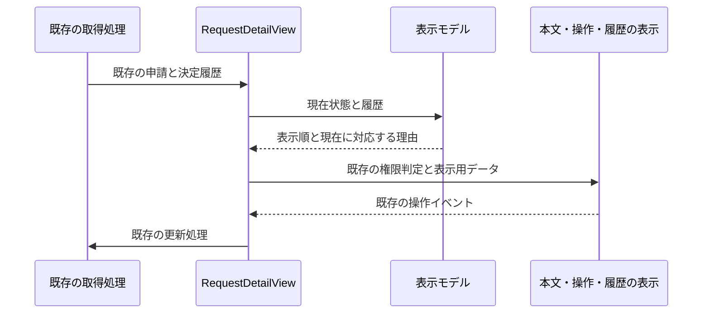

# ハーネスを更新し、申請の内容と次の操作を見つけやすくする

## 先に済ませること

2026-10-31の会話「ハーネスを更新しているので、新たに取り込みなおした上で」に基づき、共通Harnessを旧`0656986cebd23d5e19c8cac30b822bd755babf7f`から最新マージ済みmainの`eea51edcd728d32a9ef1e943ec1b64fd9477cac3`へ固定して更新する。依存の出典は`Czmirror/ai-dev-context`、MIT、取り込み後の直接改変なし。MiniFlowの基点は`7514dc64f816d82d776837ba236e22423a67a891`。開始時は変更なしで、fetch後もorigin/mainと一致した。branchは`codex/harness-refresh-ui-plan`。

更新は参照と出典記録だけで、hook・plugin・AI設定や新しい依存を自動導入しない。validate-configの警告追加、保護対象・pipe-to-shell判定の差分を確認した。Runnerと既存Profileの検査コマンドは変わらない。アプリのAPI・DB・権限は変更しない。旧参照へ戻せば更新を取り消せる。

新ルールには画面の設計図、空・欠け・失敗の表示、業務画面の説明、検証の穴の記録が増えている。今回関係する規約を読み、次の計画へ反映する。独立レビューと設定検査・Runnerを行い、結果を下へ追記する。

## 次の開発案：申請詳細で「何を直せばよいか」が分かるようにする

今は申請本文・状態・操作・履歴が離れており、差し戻された理由は下の履歴を探す必要がある。画面の上から「状態と理由→本文→次の操作→履歴」の順で読めるようにする。スマートフォンでもこの順序を保つ。

Canvaでは濃紺・深緑・明るい面を使う外観案を、別途番号付きの設計図では配置と動作を確認する。Canva案は参考で、文字や履歴に事実と違う表現があれば仕様の注釈を優先する。見た目は既定の水準B。既存CSS変数を優先し、新しい画像・フォント・libraryは追加しない。

### 画面の設計図の注釈

1. 件名と現在状態を先頭に置く。長い件名・日本語・英語でも省略だけで意味を失わない（RD1）。
2. 現在が差し戻しのとき、最新の決定が差し戻しなら理由を本文の前に表示する。理由が空なら既存の「理由なし」を使い、履歴なしや他状態では過去の理由を現在の指示に見せない（RD2）。
3. 本文は改行・空白と長い語を読める形で表示する。HTMLとして実行せず、既存の編集可能条件は変えない（RD3）。
4. 次の操作と説明をまとめる。既存のDraft/Pending/Rejectedと本人・権限の判定を維持する。差し戻しの本人は「下書きに戻す」から編集へ進み、再申請の手順は変えない（RD4）。
5. 承認履歴は古い決定から新しい決定へ並べ、日付・決定・担当者の既存ID・理由を区切る。記録されていない提出イベントや氏名を作らない。履歴がないときは「承認履歴はありません」と次の操作の説明を示す（RD5）。
6. 戻ると削除を混同させない。既存の削除確認・未保存確認・送信中の無効化を維持する。削除操作は主要操作から離す（RD4）。
7. 読込中・未選択・取得失敗を別の表示にし、失敗は再試行または一覧へ戻る操作を持つ。古い申請や他の本人の結果を再表示しない（RD6）。
8. 狭い画面は1列、通常幅は本文と操作を分ける。focusと日英で操作が失われない（RD1/RD4）。

番号に対応する絵は`blueprint.html`。データあり・履歴なし・読込中・エラーと390pxの並びを同じ1枚に添える。仮の文言は「状態と理由を確認し、次の操作へ進めます」「次の操作」。値の上限・権限・保存期間は仮に決めない。本文の不正日時等の欠け表示は「-」を仮案とし、実データの意味を推測しない。

### 作り方と受け入れ条件

仕様案は`docs/specs/request-detail-readability.md`のRD1〜RD6。表示専用部品を`RequestDetailView`から切り出し、親は既存通信と状態更新の接続を保つ。理由選択と履歴順の純粋な表示モデルを共有し、同じ決定を違う場所で違う順に解釈しない。通常操作・本文表示・履歴表示を別の変更理由でまとめる。旧履歴の描画は置き換え、二重の正本を残さない。

最新の決定はcreatedAtで求め、同時刻の記録は既存配列の順を保つ案とする。日時の欠けを新しい決定だと推測しない。理由は文字列のまま表示し、公開範囲・入力の許容値・NGワード・自動リンクを変更しない。APIの認可を正本とし、他チームの値やクライアント入力を本人情報にしない。

仕様承認前はアプリの実装を始めない。検証は既存の状態/権限/未保存/削除の回帰に加え、機能試験RD-F1〜F6と単体RD-U1〜U3。架空メモリ保存先と本番HTTPで、差し戻し→下書き→保存→提出、他人のPending、履歴0件/複数回、長文・改行・空の理由、遅延・失敗・401、通常幅/390px/日英/キーボードを確認する。完成後は設計図の1〜8と実画面を比較する。API・DB・migration・権限変更が必要なら再計画する。

## 検証の穴

現Profileはlint未整備、browser試験の自動Runner登録なし、CIなし、依存の既知脆弱性検査なし。文字形式検査は設定済みで、雛形skipはない。今回の検証は手動ブラウザ操作と既存Runnerで続ける。

追加候補は、ESLint導入（依存追加、約1分）、Playwrightによる既存機能試験の自動化（依存・ブラウザ追加、数分）、GitHub ActionsでProfile実行（CI追加、数分）、`pnpm audit --prod`（registryへ依存情報を送信、数十秒）。これらは追加承認が必要な別案で、今回のHarness更新に混ぜない。所要時間は環境依存の目安である。

## 現在の状態

Harness更新とCanva案の作成は今回の依頼範囲。アプリの新しい画面配置と表示仕様は、この計画・仕様・設計図を一緒に提示し、承認後に実装する。通常PR・レビュー・問題なければマージする従来の希望は引き継ぐが、新しい仕様の承認を省略しない。

## 検証とレビューの経過

設定検査・dry runは成功。初回Runnerは各検査（312テスト・型・build・形式・secrets）が成功したが、並行して計画文書を追加したため全体はソース変更検知でblockedになった。文書固定後の再実行結果は`.harness/reports/harness-refresh-validation-final.log`を正本とする。初回を全体成功とは扱わない。

独立レビューで不足していた削除確認の図を、注釈6に対応する小枠として追加した。未保存確認も同じ図へ添えた。Canva案の生成された誤字と、実際には記録しない作成・提出履歴は、編集transactionの下書きで修正した。保存済みデザインと修正下書きは同一とは扱わず、下書きの保存はプレビュー承認後に行う。Canvaのナビゲーションや氏名の仮表示は採用せず、既存ナビゲーションとID表示を維持する。

Canvaの識別子は`DAHZiPb4aC4`。参照はツールから得たデザインを使用し、署名付きプレビューURLは文書やソースへ残さない。ローカルの参照画像は`.harness/reports/canva-detail-draft.png`、設計図は`.harness/reports/detail-blueprint.png`。画像はGit対象外。アプリ未実装のため、設計図との完成比較・機能試験・人間の受け入れは未実施。

文書固定後のRunner再実行は全体passed。形式・型・27ファイル312テスト・build・secretsが成功し、lintは未設定のためskipped。更新した上流のprofile/guard関連テストも45件成功した。対象は上記branchのHarness更新と計画文書の未コミット差分で、機能追加の成功を示す結果ではない。新規機能のRD-F1〜F6・RD-U1〜U3は全件未実施で、承認後の実装時に実行する。アプリの実動比較も同じ理由で未実施。

### 表示の責務とデータの流れ（実装案）

取得中・失敗・未選択では表示用データを渡さず、注釈7の表示に切り替える。通信と認可の責務は既存処理に保ち、部品は取得や保存を始めない。RD-F2/F5/F6とRD-U1〜U3で理由・順序・状態切替を確認する。

最終差分の自己レビューでは、上流を直接編集していないこと、Profileの弱体化がないこと、承認前のアプリ変更がないことを確認した。独立AI再レビューも指摘なしで、前回の2点の解消を確認した。コメント・責務レビューは計画文書が対象で、新規アプリコードはない。Canva保存処理と実装後の動作は未確認。新規sessionでの運用確認は未実施。状態はHumanReview待ちで、人間の仕様承認・Canva下書き保存の承認を待つ。migration・実DB適用・アプリ依存・public API変更はない。lint・CI・browser自動化・依存監査の未整備は上の「検証の穴」を残存事項とする。

## 実装の承認

2026-10-31の会話「マージまで進めて良いです」で、直前に提示した計画・仕様・設計図・試験・Canva修正保存と通常PR・レビュー/チェック成功時のマージを承認された。以降はこの範囲を実装する。Canvaの期限切れtransactionは開き直し、同じ修正を反映して保存した。

## 実装後の結果

実装・ブラウザ検証・最終Runnerの結果は[result.md](result.md)に記録した。RD1〜RD6と図の注釈1〜8を照合した。計画時の未実施記録は当時の経過として残し、現在の実装状態は結果文書を参照する。
