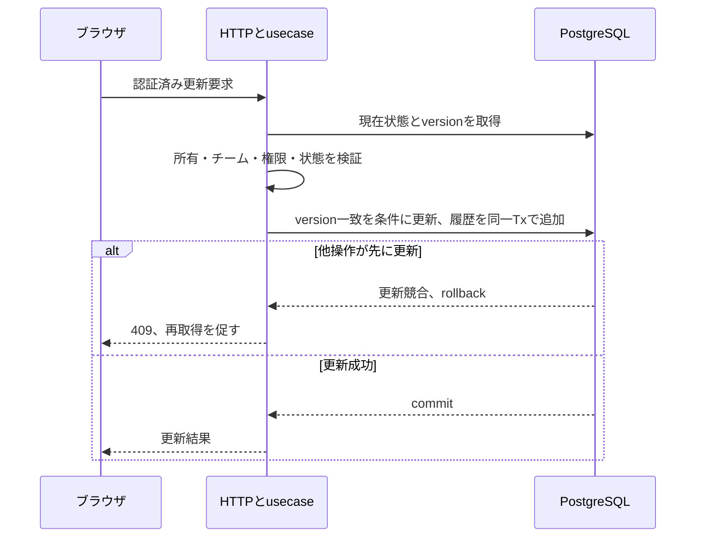
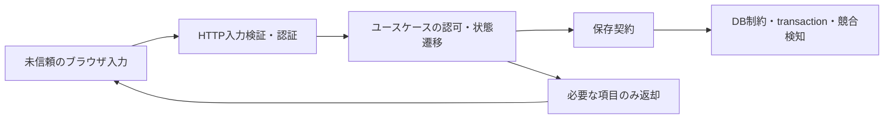

# ソース全体の改善計画

Version 1 / 2026-10-26。調査結果は [review.md](review.md)。第1段階は2026-10-26の会話「よいです、PRまで」で承認済み。第2段階は2026-10-26の仕様提示後の「進めて」により承認。第3段階以降は未承認。
対象基点: main `0384e0724bf338953f1fa78a0f33540f5f5501d2`、origin/mainと一致。既存ユーザー変更なし。
アプリの一括書き換えを避け、以下を順にレビュー可能な変更へ分ける。push/PR/DB適用の許可は計画承認に含めない。

## 第1段階: 再現可能な検証と現行実装へのテスト移行（最初の実装承認対象）

対象: R09/R10、およびR15の検証手順。アプリの挙動・公開API・権限・DBは変更しない。

1. rootのpackage.jsonにVitestとroot型検査に必要なTypeScript/@types/nodeを直接宣言し、既存pnpm-lock.yamlを更新する。既存workspaceの使用版と整合させ、無関係な依存更新はしない。
2. rootにtest/typecheck用のコマンドを整え、root/testsも型検査対象に含める。Harnessの型検査・テスト設定から呼ぶ。lintは新規導入せず、既存の未整備状態を明示する。
3. 旧srcの28件のdomainテストと19件のusecaseテストを、現行APIの実装の振る舞いを確認する形へ移す。既存現行テストと統合し、同じactorの再申請後の再決定を許可する現行仕様を維持する。旧実装の重複は全参照を確認し、この移行で不要になったものを削除する。
4. 文字列検査だけのHTTPテストは後続の認可修正時にFastify injectへ置き換える。公開registerを要求する既存テストは、この段階では仕様を変更せず不一致を記録する。
5. 既存Markdown5件の行末空白を修正する。意図的なMarkdownの強制改行は必要なら明示的な改行表現へ置き換え、段落の意味を維持する。
6. 依存追加・実行コマンド・テストの正本・旧コードの削除をREADMEとステアリングのソースの地図に反映する。.ai-context/とupstream本体は編集しない。

役割: package/lockfileは検証環境、testsは本番実装の契約、project.jsonはチェック定義、docsは手順を持つ。業務ロジックの複製をtestに作らず、I/Oをfakeで置き換える。
既存の同等実装: 旧srcとapps/apiのRequest/Approval/usecaseを照合済み。現行APIを正本とし、旧srcのPolicy仕様を無断で持ち込まない。

受け入れ条件:

- A1: node_modulesの残存状態に依存せず、宣言・lockfileからVitestと型検査の依存を解決できる。
- A2: 申請の状態遷移・自己承認拒否・role拒否・差し戻し後の再提出を現行APIの実装で検証する。失敗時は保存しないことも確認する。
- A3: 通常の型検査がworkspaceとroot/testsを両方検査し、旧srcを参照するテストが残らない。
- A4: formatの既存違反を解消し、lintのskip理由を保ったままRunnerの必須チェックを通す。チェックを削除・緩和して通さない。
- A5: DB/API/利用者の挙動を変えず、旧コードの削除範囲と現行テストの対応を差分で追える。

適用ルールと確認方法:

| ルール | 受け入れ条件 | 確認 |
| --- | --- | --- |
| Quality/TypeScript | A1/A3/A4 | pnpm frozen lockfileの整合性、root/workspace型検査、Runner |
| PrinciplesのDRY・旧実装の片付け | A2/A3/A5 | import全検索、現行usecase/domainの挙動テスト |
| Comments/Workflow | A2/A5 | 変更テストの冒頭で対象・観点を説明し、移行表と照合 |
| Safety/Libraries | A1 | 導入依存とlifecycleの調査、承認された範囲内でinstall |

検証: 設定検査 → dry run → format/typecheck → Vitest → build → secrets → 最終差分レビュー。Harness/検証設定の変更になるため、実装後は独立レビューを追加する。
クリーンinstallは作業ツリーのnode_modulesを消さず、別の一時ディレクトリで実行する。DBは起動・変更しない。新規ブラウザテストツールの導入はこの段階には含めない。

承認対象の操作: 開発依存の追加とpnpm installに伴うregistry通信。Vitest/Vite等の推移依存にはesbuild等のプラットフォーム用binaryが含まれる可能性があるため、採用版・配布元・lifecycleを実行前に確認し、無関係なinstallerは実行しない。外部audit送信は行わない。
この段階は挙動を変えないテスト移行・依存整備のため、新しい機能仕様書は作らない。試験の観点と詳細値は移行先テストを正本とし、重要ロジックを新規追加する場合は別途単体試験仕様書を作る。

## 第2段階: 認証・公開登録・入力・部分更新（別途具体化して承認）

対象: R01/R02/R04/R05/R08/R14。
公開登録を廃止し管理者作成を正規入口にする。JWT_SECRETを必須化し、PATCHの未指定値を保持、HTTP入力の型/列挙値/UUID/エラー分類を揃える。認可HTTPテストを実際のリクエストへ置換する。

未決定事項と推奨:

| 判断 | 選択肢と影響 | 推奨案 |
| --- | --- | --- |
| 最初のAdmin | 隔離されたローカルCLI / seed。公開bootstrapは未認証の入口が増える | 公開登録廃止と同時にローカルの明示CLIを用意 |
| JWT期限 | 短い期限は再ログイン増、長い期限は漏えい時の影響増 | まず8時間を候補に、運用頻度を確認して決定 |
| password変更後 | 全session失効 / 現sessionだけ維持 | 全session失効。DBのsession version等が必要 |
| 入力制約 | 現行の型・列挙値のみ / 文字数・制御文字等も定義 | 既存条件を先に厳密化し、上限はUI/API/DBと合わせて決定 |
| bind/Host/Origin | 直起動とDockerで同一 / 環境別 | 直起動localhost、Dockerは明示設定、許可Originはscheme/host/port一致 |

session変更や初期Adminの準備は業務/運用に影響するため、表の候補を実装値として固定しない。API仕様・機能試験・単体試験仕様を実装前に更新する。

## 第3段階: 保存の競合・監査・CSRF（別途具体化して承認）

対象: R03/R07/R13。
全更新へversion条件付き保存を導入し、競合は409、状態更新と承認履歴追加は同じtransactionに置く。migrationはファイル作成とDB適用を分ける。
sessionに結び付いた安定CSRF tokenとクライアントの取得管理を設計し、複数タブの正規操作を検証する。業務イベントと障害ログは安全なフィールドへ限定する。

実DBの並行approve/approve、approve/reject、edit/submit、revise/再決定、Tx失敗rollbackを隔離DBで試験する。DB適用は対象・寿命・削除範囲を示して操作承認を得る。

## 第4段階: 一覧・UI・責務・文書（別途具体化して承認）

対象: R06/R11/R12/R15。
一覧はページ単位表示、mine/pendingはサーバーの絞り込み、ダッシュボードは全件相当の集計を提供する案を基本にAPI契約を決める。
辞書は既存のja/enを維持して局所化し、新しいi18n frameworkは導入しない。画面別の表示と機能別の通信状態を分け、共有可変labelsを廃止する。domain errorとpassword操作の依存方向を整える。
未参照パネル・不要型は参照の調査後に削除する。仕様文書とステアリングは実装へ機械的に合わせず、既存契約と差分を確認して更新する。
21件以上、別チーム、役割ごとの表示、失敗時のフォーム保持、言語変更、キーボード操作をブラウザで検証する。

## 共通の境界・リスク

team/actor/roleは認証済み状態から解決し、クライアントの指定で権限を決めない。既存のAdminは全ユーザーを管理する実装であり、team限定Adminへ勝手に変更しない。
公開登録廃止と既存テストの要件衝突は、第2段階の承認で解決する。それまでは矛盾を修正済みとしない。
対象外: LINE、通知、多段承認、全体i18n、deployment最適化、upstreamのルール編集。
各段階は専用branchで差分を分ける。rollbackはその段階のcommitをrevertする案を基本とする。migration後のデータを伴うrollbackは別途決める。

## 現在の状態

第1段階の実装・開発依存追加・push・通常PR作成は、2026-10-26の会話で承認された。実装と検証の結果は [第1段階の結果](stage-1-result.md) に記録する。第2段階以降の重要仕様は、その段階の具体的な計画へ反映して承認を受ける。

第2段階の詳細計画は [認証・入力境界](../auth-input-boundaries/plan.md)。実DBへの適用と実アカウント作成は承認範囲に含めず、未実施。
