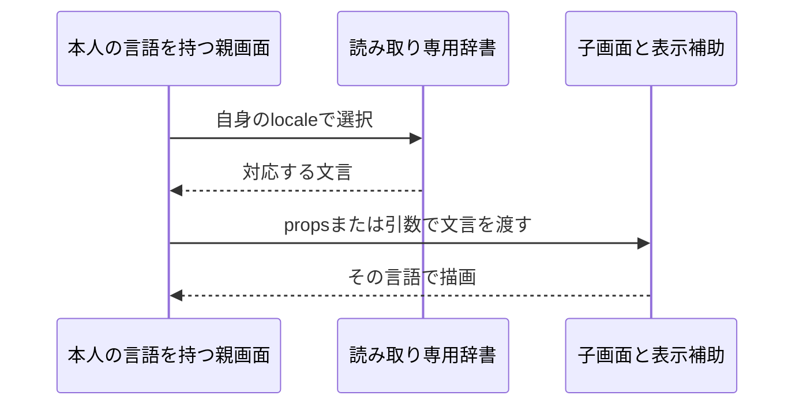

# 表示言語を画面ごとに保持する計画

2026-10-27、既知課題R11を対象とする。日本語・英語の文言と外観を維持し、別の画面インスタンスの描画で表示言語が干渉しないようにする。

## 調査と範囲

基点は`main`の`02791c8`。fetch後の`origin/main`と一致し、既存変更はない。`MiniFlowApp.tsx`はモジュールの`labels`を描画中に書き換え、子画面と表示補助関数も参照している。既存の辞書と`Locale`を再利用し、同じ文言の別定義は作らない。

辞書を表示文言専用モジュールへ移し、既存の共有可変`labels`とモジュールの初期localeを削除する。親は自身のlocaleから辞書を選び、各子画面へpropsで渡す。役割名と承認不可理由の表示補助にも辞書を明示的に渡す。辞書は読み取り専用として扱う。通信とフォーム状態は既存の所有者に残し、今回の目的と異なる全画面分割は行わない。

API・認可・DB・依存・CI・外部サービス・日時表示形式・通知文面の仕様は変えない。新しい翻訳フレームワークは導入しない。仕様書は挙動を維持する内部改修のため新設せず、既存の言語設定契約を参照する。表示言語の分離について単体試験仕様と検証記録を作る。

## 受け入れ条件と検証

- L1: 辞書を画面ツリー内で選択し、描画中に共有状態を書き換えない。日本語・英語を交互に描画して相互干渉がないことを、本番の表示経路を使う回帰試験で確認する。
- L2: ログイン、ダッシュボード、一覧、作成、詳細、アカウント設定、ユーザー管理の文言と役割・状態表示が既存どおり。実ブラウザでja/en変更と主要画面を確認する。
- L3: 言語変更で未保存の申請文面が維持され、所属変更時の破棄は既存仕様どおり。既存の本人同期試験とブラウザで確認する。
- L4: Project Profileのformat・型検査・全テスト・API/Web本番build・secretsを実行し、最終差分とコメントの意味をレビューする。lintは既存未整備のためskipped。新規依存は追加しない。

辞書は文言の変更、子画面は表示の変更、親は既存の本人設定の変更を担当する。外部I/Oは既存APIクライアントのまま。図の流れはL1/L2で照合する。新規ファイルの冒頭説明・公開型の契約・地図を更新し、旧辞書が残っていないことを検索する。仮の調整値なし。

## PRとマージ

ユーザーの「引き続き開発お願いします。通常PRまで進めてください、PRを作ったら監視して問題なければマージしてください」により、通常PR作成・監視・問題がない場合のマージは承認済み。具体的な実装計画は提示後の「よい」で承認された。

PR作成後は最終headのチェックとレビュー完了を確認する。指摘があれば同じPRへ修正し、影響する検証とレビューをやり直す。未解決の指摘、失敗・待機中チェック、マージ競合、未検証の必須事項がある状態ではマージしない。CIが設定されていない場合は、その事実とローカル検証を区別する。利用できる通常のマージ方法を使い、保護設定を迂回しない。

rollbackは今回の変更をrevertする。保存データの移行は不要。言語設定の永続化や業務仕様に変更が必要になれば計画へ戻る。
