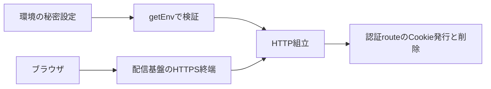

# 公開プレビューに向けた設定の安全確認

まず「設定不足でも本番として起動してしまう」経路を閉じる。今回のPRはAPI設定とその確認手順に絞り、公開先の契約・作成・デプロイは行わない。

承認の出典は2026-11-23の会話「公開プレビューの準備をその方針で進めてください。実装とローカル検証を行い、通常PRまで」。実装・ローカル検証・通常PRの作成が対象。新しい依存・DB変更・マージは含めない。

## 範囲と手順

1. [仕様](../../specs/preview-config.md)のAC1〜AC4を既存の`getEnv`で検証する。入力は環境変数の文字列で、未指定・空・形式不正・本番の組合せ違反は設定名だけの例外で拒否する。設定処理はI/Oを行わない。
2. `createHttpServer`から認証routeへCookieの安全設定を渡す。route内で`process.env`を再読込しない。既存のCookie作成・削除helperを再利用し、属性を二重定義しない。
3. AC5を本番設定のHTTP試験で確認する。公開前の手順をrunbookへ追加し、READMEから案内する。
4. Profileの書式・型検査・全テスト・ビルド・秘密検査を行い、既存のローカルブラウザ起動でも認証と更新を確認する。最終差分は独立したAIにレビューを依頼し、通常PRを作る。

基点はfetch済み`origin/main`の`4a6324c`。未マージPRはなし。既存ホームページの未コミット変更を保護するため、`codex/preview-config`を別worktreeで作業する。

## 境界と判断

環境設定の受理条件は`env.ts`、HTTPの組立は`createHttpServer.ts`、Cookieの応答は`auth.ts`が持つ。既存の役割内の変更で、層やinterfaceは増やさない。設定とCookieの重複実装は検索済みで、route内のNODE_ENV参照を削除して設定へ集約する。

Safety・Security・Input validation → AC1〜AC5の起動拒否・Host/Origin/CSRF試験。Comments・Principles → 既存helperの引数・用途・属性の一致を差分レビュー。Quality → Profileと機能・単体試験仕様書の結果。HTTPS終端は配信基盤に残し、転送ヘッダーの信用を広げない。

検証の穴: lint・依存脆弱性監査・自動ブラウザE2EはProfileにない。公開先のTLS、Cookie受理、同一サイトのドメイン構成はローカルのHTTP注入試験では証明できないため、未実施として残す。依存・CI設定は今回変更しない。

戻す場合はこのPRの設定・route変更を前進修正する。本番の設定をdevelopmentへ切り替えて検査を回避しない。強化後は既存の本番環境も必須設定を満たす必要がある。仮の調整値はなし。
