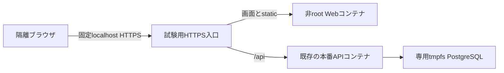

# Webも本番コンテナで配れるようにする

2026-11-25の会話「PR #30に問題なければマージしてください。引き続き、公開プレビューに向けた開発とE2Eもお願いします」に基づく。PR #30は最新CI成功・レビュー指摘なし・未解決threadなしでマージした。fetch済みmain `2a61f42`が基点。別worktreeで未完了のホームページ作業を保護する。

今回は配布可能なWeb成果物を1つ用意する。公開先・DNS・信頼されたTLS・共有デモ運用の作成は行わない。[仕様](../../specs/web-container.md)と[試験](../../tests/functional/web-container.md)に沿い、通常PRまで進め、新規PRはマージしない。

1. 既存APIと同じ公式Node 22のdigest、lockfile、lifecycle script停止を使う。Web専用Dockerfileと専用ignoreで必要な入力だけを渡す。APIのcontextは変更しない。
2. Docker buildだけ`MINIFLOW_STANDALONE=1`でNextのstandalone出力を使い、必要なruntimeとstaticを非rootのimageへコピーする。通常のローカルbuild/startは変えない。API接続は公開情報のbuild引数`NEXT_PUBLIC_API_BASE_URL`で既定`/api`。秘密は渡さない。
3. 既存の専用ComposeへWebを追加し、localhost:43152をWebコンテナへ向ける。既存HTTPS proxy・22項目のdriverを再利用し、ホストのNext起動は不要にする。
4. ダミーの.envと鍵ファイルがbuild/runtimeへ入らないこと、非root・read-only起動、HTMLとstaticの応答/キャッシュ、image/Next build IDを照合する。サイズを測るが、性能改善とは断定しない。
5. 前回個別承認された同じ固定localhost:55449の使い捨てDBだけに既存9件migrationと架空4人を投入し、E2E後に専用環境を削除する。型検査・既存404テスト・build・秘密検査・独立レビューも行う。

DockerfileはWeb成果物の組立、専用ignoreは入力境界、next.configはDockerの出力方式と配信header、Composeはローカル試験の接続だけを担当する。通信・認証・UI・業務ロジックを複製しない。Nextのstandaloneとstaticの配置は[公式資料](https://nextjs.org/docs/app/api-reference/config/next-config-js/output)と実際のNext15.5.12で確認する。

Security/Sensitive data→allowlistのbuild入力とダミー混入試験。Web delivery→実HTTPのHTML/static headerとbuild識別子を照合。Database→個別承認の固定使い捨てDBだけを初期化し終了後に破棄。Quality→同じ22項目をWebコンテナへ接続して確認する。

検証の穴は既存どおりlint・依存脆弱性監査・CI自動E2E。今回はこれらの基準を変えない。ホストCPU負荷で並列テストがtimeoutする場合は、期待値/timeoutを変えず直列実行とCIを照合する。UI変更・依存追加・DB schema/API変更はない。性能目標は未定。/tmpの容量16MiBは既存API試験と揃えた仮のローカル試験上限である。

実動試験で15項目後の本人設定ログインが描画待機15秒で失敗したため、完了した業務/管理contextを本人設定の前に閉じる。期待値と上限は維持する。試験の資源解放として既存E2Eに最小変更し、同じ専用DBを再作成して全項目を再実行する。
