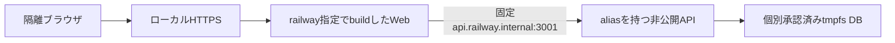

# Railway無料枠の起動準備

2026-11-26のユーザー指示「まずは無料枠で試したいです。Railwayで公開準備を進めてください」に基づく。同じ目的のPR33が未完了のため、既存branch codex/same-origin-previewへ追加する。fetch済みmain aa44b21、branch基点3944809。元workspaceのホームページ変更は保護する。

Railwayの内部DNSはapi.railway.internalで、現在の固定apiだけでは解決できない。[既存接続仕様](../../specs/same-origin-preview.md)を更新し、公開先をcompose/railwayの閉じた選択肢でbuild時に決める。任意のURLや利用者入力から転送先を作らない。

1. 純粋関数apiProxyは配信先名から固定内部URLを選び、未知/空値を固定messageで拒否する。秘密・DB・ネットワークI/Oなし。Next設定が呼び出す。
2. Web Dockerfileは公開情報のMINIFLOW_DEPLOY_TARGETをbuild引数に追加し、既定composeを維持。railwayだけapi.railway.internal:3001へ転送する。通常buildは転送なし。
3. 専用ComposeのoverrideでRailway内部名のalias/Host/build引数を再現し、既存23項目E2Eと単体・標準チェックを実行する。実Railwayでの成功とは報告しない。
4. 無料枠の設定表と公開開始条件をrunbookに残す。Web/API/PostgreSQLの3サービス、課金変更なし、サービスURLはWebだけ。秘密と実DB操作は接続先確定後に扱う。

既存転送先を探しnext.configの1箇所を置換する。関数は転送先の決定だけ、Nextは配信、Dockerfileは組立、overrideは試験接続を担当し、業務/API認可を追加しない。Input validation/Security→2選択肢と未知拒否→単体試験。Web delivery→実manifest/headerと23項目。Database→同じ固定localhost:55449/miniflow_container_testの空tmpfsへ既存9migration/架空4人だけを投入し終了後破棄。

Railway接続は未完了。接続依頼を重複検索後TickTickへ登録済み。接続までcloud作成/公開URL/実DB初期化は未実施。有料upgrade・支払い方法追加・任意URL proxy・不特定多数への資格情報公開は対象外。Free/Trialの残クレジットとプランは接続後に確認する。標準lint/依存監査/CI自動E2Eの既存の穴は今回変更しない。性能目標は未定。無料枠の常時稼働/起動時間は未検証。
