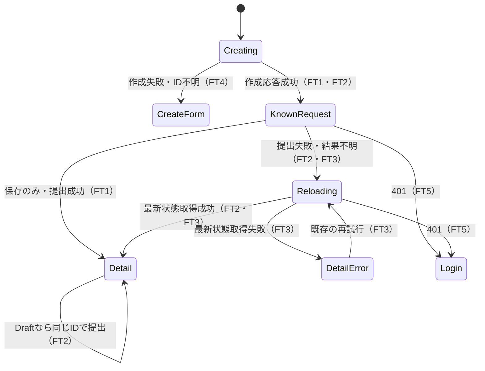

# 申請作成後の途中失敗から復帰する計画

- 計画version: 1。2026-11-03作成、2026-11-04承認受領。以下の仕様の範囲で実装する。
- 要求: 全体レビューの改善を段階的に進める。今回は作成成功後の提出・再取得失敗で、新規作成を繰り返してしまう問題を扱う。
- 関連Issue: なし。
- Git同期: main、localとorigin/mainはともにc4be8c5。git fetch origin成功、ahead/behindは0/0。着手時の既存変更なし。取り込み不要。
- 仕様書: [request-create-recovery.md](../../specs/request-create-recovery.md)。試験仕様書: [機能](../../tests/functional/request-create-recovery.md)・[単体](../../tests/unit/request-create-recovery.md)。承認済みの草案から移動・分離した。

## 調査と選択肢

`MiniFlowApp.createFromForm`は作成、任意の提出、一覧更新、詳細取得がすべて成功したあとに作成フォームを空にする。途中失敗すると作成済みIDへの導線がなく、再操作は新しいPOSTになる。`handleOpenDetail`には詳細取得の失敗表示と再試行があり、`currentRequestDetail`には古い応答を破棄する仕組みがある。これらを再利用する。

推奨案は、作成応答を受け取った時点で新規作成を完了として扱い、既存の詳細画面を復帰先にすること。API・DB・依存の変更なしで、成功が確認できた作成の再実行を防げる。

代替案は、作成APIに操作識別子と永続的な重複防止を追加すること。作成応答自体が失われた場合にも対応できるが、公開API・保存契約・migrationの検討が必要になる。今回は前者を提案し、後者は別段階にする。前者で完全な重複防止を実現したとは報告しない。

## 提案する挙動

詳細は仕様草案AC1〜AC6に従う。作成成功後はフォームを空にして対象IDを詳細画面へ保持する。提出失敗時は、提出結果を断定せず最新状態を取得する。Draftなら既存の提出操作、Pendingなら提出済みの表示を使う。最新状態の取得にも失敗したら、既存の詳細再試行を使う。401はログインへ戻し、旧申請を再表示しない。

新しい部品・配置・確認ダイアログは追加しない。既存の詳細画面への復帰を修正し、説明文だけ補うため、UI visualの「不具合を元の形に直すだけの修正」として新しい画面設計図は省略する。既定の見た目水準Bと既存CSSを維持する。文言案は「下書きは保存されています。提出結果を確認できませんでした。最新の状態を確認してください。」。英語もmessagesへ追加する。

Creating以外から新規作成を呼び直す遷移は置かない。作成済み申請と別の新規申請を作るため、利用者が作成画面を改めて開く操作は引き続き許可する。

## 実装範囲と責務

1. `apps/web/src/lib/requestCreation.ts`（新規）: 作成・任意の提出の結果を、作成未確認と作成済みに区別して返す。通信関数を受け取り、画面状態・cookie・保存先を持たない。提出失敗を作成失敗へ戻さない契約をコメントに書く。
2. `MiniFlowApp.createFromForm`: 上記結果を既存のフォーム・詳細画面へ反映する。作成応答直後のID保持、フォーム初期化、送信中の連打と画面移動防止を担当する。認証・詳細取得の世代と操作tokenを照合し、旧操作の成功・失敗・finallyが新しい本人情報を変更しない。大規模な画面分割は今回に混ぜない。
3. `messages.ts`: 保存成功と提出結果不明を区別する日英の文言を持つ。既存の成功文言と再試行操作は再利用する。
4. `tests/apps/web/RequestCreation.spec.ts`（新規）: 本番の作成処理に通信fakeを渡し、途中失敗・呼び出し回数・IDを検証する。文字列検索だけの試験にしない。
5. `docs/specs`、`docs/tests`、`docs/runbook.md`、`.harness/steering/project.md`: 承認後に仕様・試験・失敗時の復帰手順・ソースの地図を更新する。`.harness/upstream`と`.ai-context`は変更しない。

既存検索では、作成の連続処理はMiniFlowAppと旧補助CreateRequestPanelにある。後者は今回の画面から呼ばれておらず、今回の範囲で削除・統合しない。MiniFlowApp内で置き換えた旧連続処理は残さない。詳細再試行は既存処理を再利用するが、401等の境界変更後は呼ばない。

## 境界と入力

| 入力・境界 | 契約 | 確認 |
| --- | --- | --- |
| title/body | 既存のstring・非空条件とtrimを維持。新しい長さ・Unicode規則を追加しない | 既存入力試験とFT4 |
| 作成済みID | 成功応答の対象IDだけを使う。利用者が入力したIDに置換しない | UT2・UT3 |
| 本人・所属・役割 | APIで認可。クライアントは世代が変わった応答を破棄する | UT5・FT5 |
| 更新通信 | 既存APIクライアントとCSRFを使う。自動的な更新再送はしない | 呼び出し回数の試験 |
| 作成失敗・応答消失 | 作成済みかを推測しない。入力を保持し、作成済み一覧を確認できる説明を出す | UT4・FT4 |

申請本文・認証情報をURL・ログ・localStorageへ新たに保存しない。APIは既存の設定済み接続先のみ。今回の変更はブラウザ内の結果処理であり、権限・監査ログ・DBは変更しない。

## 検証とルールの対応

- K1（Web・Admin screens）: 二重操作、保存成功後の部分失敗、再試行で同じ対象に戻ること → FT1〜FT4、UT1〜UT4。
- K2（Security・Design）: 認証・所属変更後に古い応答を反映しない → FT5、UT5。状態の所有者と操作tokenの寿命をレビューする。
- K3（Principles・Comments）: 作成結果の分類はrequestCreation、表示はMiniFlowAppに置く → import・公開契約・旧連続処理の削除を差分レビューで照合する。
- Profile: validate-config、validateの実行予定を確認後、テキスト形式、型検査、全テスト、本番build、秘密情報検査を実行する。buildはNEXT_TELEMETRY_DISABLED=1を使う。依存追加はしない。
- ブラウザ: 架空データのメモリAPIまたは通信差し替えで提出・詳細取得を失敗させ、FT1〜FT6を確認する。console.errorと未処理例外を確認し、1280pxと390px、日英で説明と再試行操作を確認する。実データ・実ユーザーの作成は行わない。実行できない場合は未検証と報告する。
- 検証の穴: lint、CI、ブラウザ試験のProfile登録、依存脆弱性監査は未整備。CI・主要ブラウザ試験の整備は後続計画にする。候補は既存検査のCI実行、Playwright等の主要フロー試験（依存追加が必要）、pnpm audit（外部通信が必要）。時間は環境確定前のため未計測。今回は検証基準を変更しない。

## リスクと承認

作成応答が失われた場合、別タブからの同内容作成、ページを閉じた後の再作成は防げない。提出結果不明時の取得も失敗した場合は、再取得できるまで提出済みかを断定しない。復帰先は既存の詳細画面なので、一覧更新の失敗を新規作成失敗として扱わない。

rollbackは今回のWeb・文書差分だけを戻す。DBの変更はない。push・deploy・依存追加・DB操作は計画承認に含めない。新しいAPI・永続的な重複防止・通知等が必要になれば再計画する。

人間の計画承認: 2026-11-04、この会話で計画を提示して「この範囲で実装を進めてよいですか？」と確認した応答「良いです」を受領した。限定範囲での修正と、提示済みの仕様・試験草案を対象とする。push・deploy・DB操作・依存追加は含めない。

PR操作の追加承認: 同じ会話で実施結果とブラウザ未検証を報告した後、「pr作ったら監視して問題なければマージして引き続き開発を進めてください」と依頼された。今回の修正のpush・PR作成・監視・問題がない場合のmainへのマージを対象とする。次の改善の未提示仕様やdeploy・DB適用の承認には広げない。

再開時の確認: 2026-11-04もgit fetch origin成功、HEADとorigin/mainのahead/behindは0/0。既存変更は前回作成した本計画・草案のみ。追加の実装上の判断として、一覧再取得を作成完了の条件から外し、詳細画面へ直接復帰する。認可・入力規則・保存形式は変更しない。

ブラウザ確認: CUAで確認したところ「Local browser use is disabled in Work settings」、ネイティブ操作もMacロックで利用不可。機能試験は未実施として残す。既存の設定を迂回・変更しない。

## 後続の改善候補

1. 古い画面のversion照合と、作成応答消失にも対応する重複防止。
2. CIと主要フローのブラウザ試験。
3. 公開前のログイン試行制限。
4. URLに対応する画面遷移、責務分割、現行文書の整備。

上記は候補であり、未提示の仕様・外部操作の包括承認を求めるものではない。
