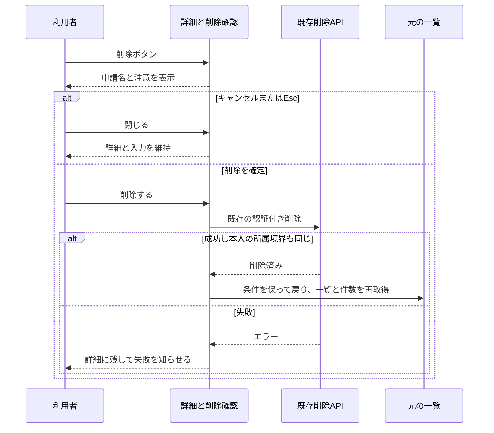

# 不要な申請を画面から片付けられるようにする

## 今回すること

下書きや差し戻しになった申請の詳細に「この申請を削除」を追加する。押すと申請名と注意書きが出て、最後に「削除する」を選んだときだけ実行する。間違えて押した場合はキャンセルできる。

削除後は一覧へ戻り、件数も更新する。前回追加した状態フィルターはそのまま使える。削除した申請を画面から元へ戻す機能はないため、確認画面にその点をはっきり書く。実際の保存先では既存仕様どおり削除済みの記録を残す。

## 今回しないこと

承認待ちや承認済みの削除、権限の拡大、一括削除、完全削除、復元機能は追加しない。実DBへの操作や、利用中の申請の削除も行わない。試験は架空のメモリデータだけで実施する。

## 実装と確認の詳細

2026-10-28。基点は`main`の`e9c1d59`。fetch後もremoteと一致し、既存変更なし。APIの`POST /requests/:id/delete`は同teamの本人またはAdmin、Draft/Rejectedのみを許可し、論理削除と競合検知も実装済み。Webの既存transitionRequestはdeleteに対応するが、詳細に操作欄がない。

仕様は`docs/specs/request-delete-ui.md`。試験草案は`docs/tests/functional/request-delete-ui.md`。この計画と仕様を一緒に承認対象にする。

- 詳細の表示条件は既存の本人・管理者・状態の判断を使う。重要な条件は単体試験する。表示でサーバー認可を代替しない。
- 確認画面は削除確認専用componentにし、申請名・注意書き・実行とキャンセルを表示する。通信は所有しない。既存のnative dialogとReactの慣習を調べ、focus管理とEscを確認する。親に全描画を追加せず、別の理由で変わる確認UIを分ける。
- 親は既存transitionRequestを呼び、成功・失敗を画面へ反映する。既存のセッション/詳細取得の世代と本人の所属境界を照合し、旧応答を適用しない。新しい汎用通信層は作らない。
- 成功後は旧詳細と入力を消し、元一覧へ移って再取得する。状態フィルターの所有者は既存の取得hookのままとする。削除失敗で成功通知や画面移動を行わない。
- 文言はmessages、外観は既存のdanger色・余白・focus tokenを使う。UIは既定の水準B。新しい仮の調整値が必要なら記録し、不要なテーマ追加は行わない。
- 新規ソースの役割・非同期の失敗契約・状態寿命を説明し、ソースの地図を更新する。状態名・権限の同じ知識の既存実装を検索して再利用する。

確認するのは、削除できる条件とできない条件、キャンセルでは未送信、成功時だけ一覧から消えること、失敗・連打・遅い応答の扱い。既存の認証・チーム境界・競合のテストも維持する。単体試験仕様は`docs/tests/unit/request-delete-ui.md`に作る。

本番HTTPと架空メモリ保存先の専用Webで実ブラウザ確認する。広い/狭い画面、日英、focusとキーボード、状態フィルターと集計更新を確認する。既存の手動確認DBは変更しない。Project Profileのformat・型検査・全テスト・API/Web本番build・secretsを実行する。lintは既存未整備のためskipped。自己レビューと削除の権限条件・認証境界の独立AIレビューを行う。

## 承認とPR

通常PRの作成、レビューとチェックの監視、問題がない場合のマージは今回の会話で承認済み。この削除画面の仕様と実装範囲は提示後の「よいです」で承認された。対象の実申請・実DBの削除までを承認されたとは扱わない。

PRは最終headのレビュー完了・有効な指摘なし・失敗/実行中チェックなし・競合なしを確認してマージする。CI未設定はCI成功と区別する。rollbackは今回のcommitのrevertで、データ移行はない。既存API・DB・認可の変更が必要なら再計画する。
