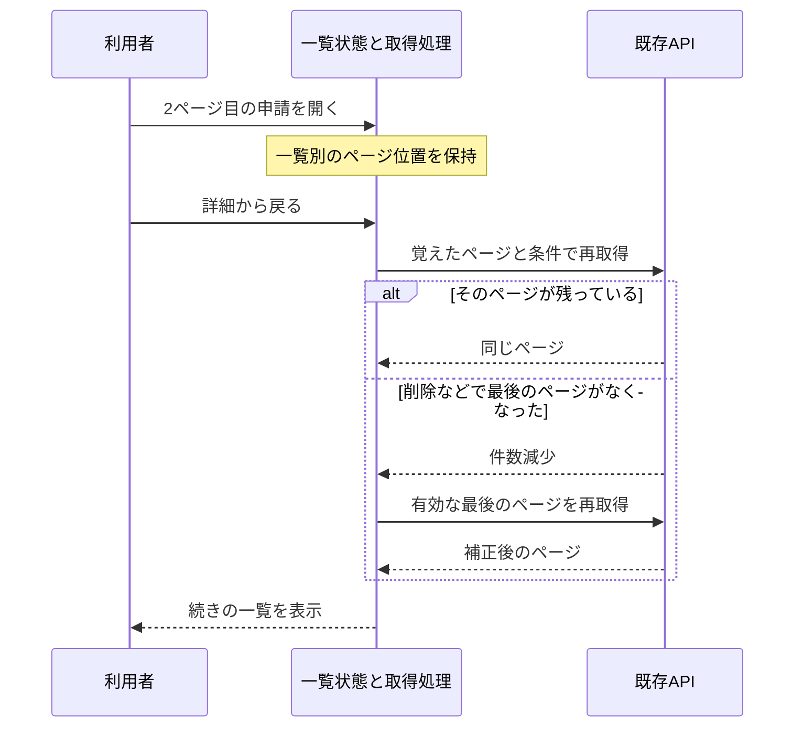

# 申請を見終わったら、一覧の続きへ戻れるようにする

## 今回したいこと

2ページ目で申請を開き、確認して一覧へ戻ったら、同じ2ページ目から続けて見られるようにする。今は詳細を開くたびに一覧のページ番号を忘れるため、戻ると1ページ目から探し直す必要がある。

申請一覧・自分の申請・承認待ちで、それぞれ最後に見たページを覚える。絞り込み条件を変えたときは、これまでどおり1ページ目から探す。削除や承認で最終ページの申請がなくなったときは、残っている最後のページを表示する。

別の利用者やチームへ切り替わった場合は、以前のページ位置を引き継がない。ブラウザを再読込したときも最初からになる。URL・ブラウザ保存先への保存は今回追加しない。

## 要求・提案と承認

通常PRを作り、レビューとチェックに問題がなければマージする操作は、2026-10-28の会話で依頼済み。この計画と仕様案は、提示後の「よいです。その計画で進めて、通常PRを作成し、レビューとチェックに問題がなければマージまでお願いします」で承認された。

選択肢は、現状の1ページ目への復帰を保つか、一覧ごとに位置を覚えるか。複数の申請を続けて確認しやすくするため、後者を提案し承認された。画面を切り替えて戻る場合も覚える。未確定事項はない。

## 調査と影響範囲

基点は`main`の`711a411e5e04dc3257a3e4c3cda00aad9a7b8e12`。fetch後も`origin/main`と一致し、作業開始時の変更はない。実装時のbranchは、既存慣習に合わせ`codex/request-list-position`とする。

`useRequestCollection`は一覧条件を一覧別に保持する一方、画面を含むcontext変更でページを1へ戻している。`loadRequestCollection`には、件数減少で指定ページがなくなった場合に最後のページを再取得する既存処理がある。これは再利用する。旧レビューR06のページ送り改善の続きで、既存のフィルター仕様SF3の「画面移動で1に戻る」だけを変更する。

API・DB・migration・依存・権限・デザインは変更しない。件数は既存どおり20件単位。ダッシュボードの短い承認待ち一覧は常に最初のページで、通常の承認待ち一覧の位置とは分ける。実DBの操作は行わず、実動確認は架空メモリデータで行う。

## 仕様と確認対象

仕様は`docs/specs/request-status-filter.md`のSF3とLP1〜LP4へ反映する。機能試験は`docs/tests/functional/request-list-position.md`、重要ロジックの単体試験は`docs/tests/unit/request-list-position.md`にケースを用意する。

| 確認対象 | ルールと守る条件 | 確認方法 |
| --- | --- | --- |
| LP1 | Workflow/Web: 詳細から戻っても一覧別のページ位置と状態条件を保持する | 2ページ以上の架空申請で、戻る・削除・画面切替を実ブラウザ確認 |
| LP2 | Input validation: 条件変更で1へ戻し、件数減少では有効な最終ページへ補正する | 正常・境界・0件・不正ページの単体試験と最終ページ削除の操作確認 |
| LP3 | Security/Next.js: 認証・所属・権限変更時はページを破棄し、旧応答を新画面に反映しない | 状態寿命の単体試験、認証失効と遅延の実ブラウザ確認、最終差分レビュー |
| LP4 | Principles/Comments: 一覧状態の所有者を1つにし、通信や描画と混ぜない | 変更module・hookの依存、reset条件とコメントをレビュー |

## 作り方

一覧別のページと状態条件は同じ寿命なので、相互に矛盾しない小さい状態moduleにまとめる。moduleは画面名・本人の境界識別子・入力を受けて選択状態を返し、通信・React・認証処理は持たない。`useRequestCollection`がReact状態と取得世代、通信の順序を持つ。既存の単一selectionとfilter更新は置き換え、並行した正本を残さない。

`loadRequestCollection`の補正結果を、画面へ表示するページと記憶するページの両方へ反映する。補正に伴う余分な再取得や、遅い結果による上書きを起こさないよう、取得世代と照合して更新する。実装上の細部はこの契約の範囲で決める。親の`MiniFlowApp`へ一覧固有の選択処理を増やさない。

図の保持・復帰はLF1/LF2、最終ページ補正はLF3、取得中の境界変更はLF4で確認する。

## 入力と境界

| 入力 | 制約・既存契約 | 処理と試験 |
| --- | --- | --- |
| ページ操作 | UI内部の数値。1以上の整数で取得済みの総ページ以下だけ有効 | 不正値・範囲外を無視し、状態を壊さない。単体試験する |
| 状態条件 | 既存の固定選択肢だけ。未知値は拒否 | 既存parserを再利用し、条件が変わると当該一覧だけ1へ戻す |
| APIの件数減少 | 既存取得処理の結果から有効ページを計算 | 既存の1回限り補正を再利用し、0件は1ページ目の空表示とする |
| 本人・チーム・権限 | サーバーで確定した本人情報から既存識別子を構成 | 境界変更後の状態・旧応答を採用しない。ページ位置を認可の根拠にしない |

ページ位置だけをログイン中のReact状態に保持する。申請本文・cookie・秘密値を新しい保存先や外部へ送らない。認可とAPI入力検証は既存サーバーの責務を保つ。新しい文字列入力や業務上の上限は追加しない。仮の調整値はない。

## 検証・レビュー・完了

実装前に既存のページ・条件・reset処理と試験を再確認し、同じ知識を重複させない。変更した状態moduleとhookの冒頭・公開契約に、読む状態、更新条件、保持期間、補正と旧応答の扱いを書く。ソースの地図も更新する。

Harnessの設定検査と実行計画を確認後、文章形式・型検査・全試験・API/Web本番build・secretsを実行する。lintは既存未整備のためskipped。専用Webと架空メモリAPIで2ページ以上の一覧、削除、0件、再試行、遅延、認証失効を確認する。日英・狭い画面・キーボードで既存のページ送りも確認する。必要な実動確認ができなければ、未実施のままマージしない。

自己レビューとGitHub自動レビューを行い、認証境界を変更する差分が生じる場合はHarnessに従い独立レビューを追加する。最終headのレビュー完了、指摘解消、失敗・実行中チェックなし、競合なしを確認して通常PRをマージする。CI未設定は成功と区別する。rollbackは今回のcommitのrevertで、データ移行はない。API・権限・依存・保存方式の変更が必要になったら再計画する。
