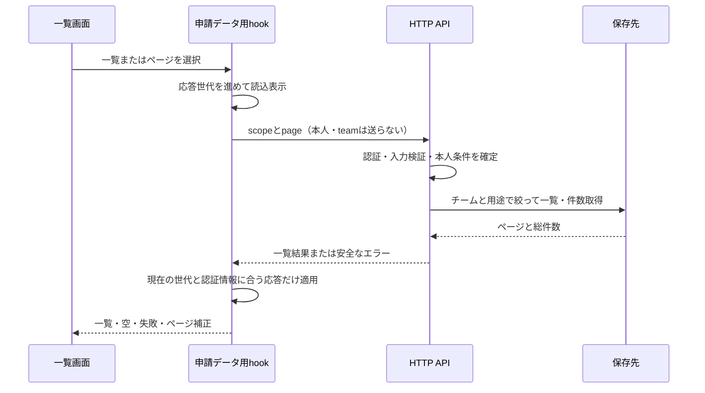

# Plan: 申請一覧のページ送りと全件集計

- 計画version: 1、2026-10-27承認。
- 要求: 2026-10-27の会話「引き続き開発お願いします」。既存レビューR06を優先する提案。
- 基点: `main`、fetch後もlocalと`origin/main`は`3f78ca0e1b24ca2df16051455afe43dfcef6c8f9`。作業ツリーに既存変更なし。取り込み不要。
- 仕様・試験草案: `spec.md`、`tests.md`。現在のAPI契約の正本は`docs/API.md`。実装時に正本とOpenAPIを更新し、この草案は承認経緯として残す。

## 問題と選択

Webの`requestApi.listRequests`はpage/limitを指定せず、`MiniFlowApp`は返ったitemsだけで一覧の分類と集計を行う。APIの既定limitは20件で、21件目以降が一覧・自分の申請・承認待ち・集計から欠ける。

全件をページ単位でWebに取得する案は、小規模では簡単だが件数に応じて通信とメモリが増える。推奨は、各一覧をサーバーで絞って20件ずつ取得し、集計もサーバーで行う案。任意検索や並び替えは今回追加しない。

## 実装範囲

1. 既存GET `/requests`に省略可能な`scope`を追加する。値は`all`（既定）、`mine`、`pendingApprovals`。本人とチームは認証情報から解決する。既存のscopeなしの呼び出しは維持する。
2. GET `/requests/summary`を追加する。認証ユーザーのチームの削除済み以外を対象に、合計・自分・承認待ち・承認済み・差し戻し・下書きの件数を返す。全申請DTOや本文を集計のために転送しない。
3. Webの申請一覧・自分の申請・承認待ちに前後のページと表示範囲・総件数を示す。1ページ20件、一覧を切り替えたら1ページへ戻す。ダッシュボードの承認待ちは用途別取得の先頭5件を使う。
4. 作成・編集・状態変更後に一覧と集計を再取得する。空になった最終ページは最後の有効なページへ補正し、0件は1ページの空表示にする。
5. 認証切り替えや一覧切り替え前の遅い応答を新しい画面に適用しない。失敗時に未取得の件数を0と表示せず、エラーと再読み込み操作を示す。

DB schema・migrationファイル、既存の参照権限・申請承認条件、依存、CI、通知機能は変更しない。前段階のUI値を利用し、水準Bを維持する。前段階の実際の200%拡大の未確認は引き継ぎ、今回の成功で解消扱いにしない。

## 境界と責務

| 担当 | 役割と状態の所有者 |
| --- | --- |
| HTTP route/schema | queryを検証し、認証された本人・role・teamから用途を確定する |
| 一覧・集計usecase | 用途の条件と集計契約を決める。保存先はportを通じて呼ぶ |
| Repository port/Prisma | 本人・チーム条件を共通化し、絞り込み後のページと件数を返す。DB I/Oを所有する |
| requestApi | 型付きの一覧・集計のHTTP通信だけを担当する |
| Webの申請データ用hook | 選択中の一覧・ページ・読込・失敗・応答世代を保持する。認証情報が変わったら破棄する |
| 一覧とダッシュボード | propsから表示し、ページ移動・再取得の意図を親へ返す。業務集計や直接通信は持たない |

既存の`stats`・`myRequests`・`pendingApprovals`の全件を仮定した派生処理は置き換えて削除する。通信処理を既存の巨大なコンポーネントへ追加せず、申請データの取得状態をhookへ分ける。認証、アカウント、ユーザー管理の全体分割は行わない。ファイル追加・役割変更はステアリングの地図に反映する。

図の正常経路はFT1〜FT3、失敗と世代の照合はUT3・FT4、チーム境界はUT1・FT5で検証する。集計も同じ認証境界を通る。

## 入力・契約の判断

| 入力 | 許可・拒否・既定 | 検証場所 |
| --- | --- | --- |
| scope | 省略はall。3値だけ許可し、空・null・未知値を400 | HTTPとusecase |
| page/limit | 既存契約を維持。Webは20件。正の整数、limit最大100、安全なoffset | HTTPとusecase |
| mine | 現在の本人だけ。任意のcreatedBy指定は受け付けない | HTTPから渡す認証情報とusecase |
| pendingApprovals | Pendingかつ自分以外。Applicantは既存画面と同じ0件。Admin/Approverは同一teamだけ | usecaseと保存先 |
| scopeと既存filter | mineは既存status/date条件とAND。pendingApprovalsはstatus省略またはPendingだけ、それ以外は400。includeDeleted=trueでもPendingのみ | usecase |
| summary | queryは受け付けない。削除済みは全指標から除外。承認待ち件数はチーム全体のPending、自分の件数は本人 | HTTPとusecase |
| 並び順 | 既存の作成日時降順を維持し、同時刻はID降順で安定させる | Prisma |

同時更新中の別HTTP応答同士の完全な時点一致は保証しない。1回のsummary内の集計は同一スナップショットで取得する。ページ位置が更新で変わり得るため、画面の再取得で最新状態を示す。カーソル式への変更は今回含めない。

## 実装・検証

- 変更対象: shared型、HTTP route/schema、一覧・集計usecase、repository契約/Prisma、Web取得hook/API/一覧/ダッシュボード、CSS、API/OpenAPI、tests、ステアリングの地図。
- ルール対応: Security/SQL → 全queryのteamと本人条件 → 他team・他本人のHTTP/保存先テスト。Input validation → scopeと既存filterの組合せ → 400と正常値。Design/Web → 応答世代と認証reset → 遅い応答・ログアウト・ページ変更。Quality → 既存Runnerと新規テスト、実ブラウザ・実DB。
- 検証順: format・型検査、単体/HTTPテスト、build、secrets、専用DBの絞り込み・集計、ブラウザのページ送り・更新・エラー、自己レビューと独立レビュー。
- 機能/単体の試験項目は`tests.md`。既存の検証基準や時間制限は変更しない。

## DB検証の限定承認に含める対象

既存の確認用DBを増量せず、専用の一時コンテナ`miniflow-pagination-check-20261027`を作る。手元にある`postgres:16-alpine`だけを使い、127.0.0.1の空きport（候補60427）に限定する。DB名は`miniflow_pagination_check`、保存はtmpfs、既存volumeは使わない。既存migrationをこの新規DBにだけ適用し、2チーム・3役割・各状態・45件以上の架空申請を準備する。実DBの一覧・集計とブラウザ操作を確認し、終了後は今回作ったコンテナだけを削除する。データは消える。既存DB、実ユーザー、共有環境には接続しない。

migrationファイルの追加は不要だが、試験用DBへの既存migration適用はDB操作としてこの計画で明示する。確認環境は別portのAPI/Webを起動し、既存の手動確認環境を停止しない。JWT秘密値は一時プロセス内で生成し、表示・保存しない。

## リスク・承認

主なリスクは、用途の絞り込み条件と件数の不一致、遅い応答による他画面への上書き。条件の再利用、認証世代の照合、40件超の回帰試験で確かめる。性能は今回の架空データ量の範囲でのみ確認し、大規模性能を保証しない。rollbackはアプリ差分の取り消しで、DB schemaの復旧は不要。

人間の承認: 本計画を提示した会話にユーザーが「ok」と回答（2026-10-27）。提案したscope・summary・ページ補正・一時DB検証を含む計画を提示し、明示的承認後に実装する。push・通常PRは最終差分と結果を確定してから、会話上の承認範囲を照合する。
