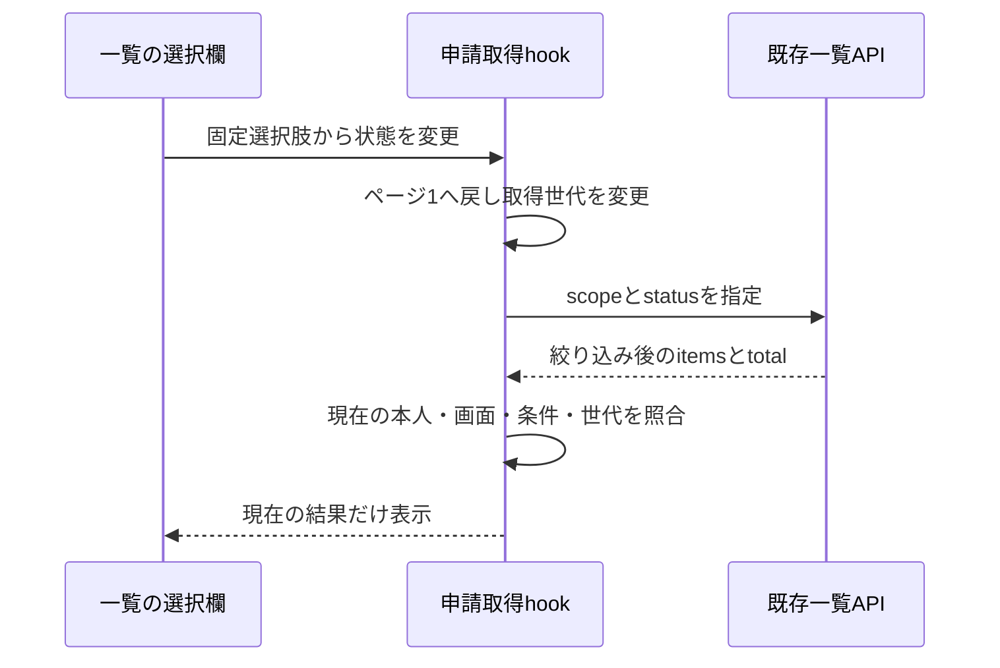

# 申請一覧の状態フィルターの計画

2026-10-28。仕様草案は`docs/specs/request-status-filter.md`。通常PR作成・レビューとチェックの監視・問題がなければマージする操作は今回の会話で承認済み。具体的な仕様と実装計画は、平易な操作説明を追加した後の「よいです」で承認された。

## 調査・変更範囲

基点は`main`の`c4ead17`。fetch後の`origin/main`と一致し、既存変更はない。APIは既存のstatus条件をscopeとANDで適用できる。Webの`requestApi.listRequests`はまだstatusを送らず、`RequestList`にも選択欄がない。既存の状態文言とAPI列挙値を再利用する。

- `requestApi.ts`: 既存listRequestsのoptionsにstatusを渡し、既存APIへqueryとして送る。HTTPと型の責務を維持する。
- `requestCollection.ts`: 状態条件を初回・最終ページ補正の両方へ渡す。全件集計には条件を渡さない。
- `useRequestCollection.ts`: 一覧ごとの選択条件の寿命を管理し、条件を取得世代とキーに含める。ページ・条件・本人が変わった旧応答を破棄する。認証/所属/権限のresetで条件も初期化する。
- 一覧表示: 表示用componentへ選択値とcallbackを渡す。native selectと既存CSS tokenを使い、日英labelと該当なしを表示する。通信・認可の判断は持たない。必要ならRequestListを表示専用ファイルへ移し、旧定義は削除する。全画面の分割は行わない。
- 重要な選択条件の列挙・変換は小さい純粋関数へ集約する。既存のshared型と文言を再利用し、同じ状態名の別の正本を作らない。新規ソースの役割・契約を書き、地図を更新する。

仕様の保持方式は「画面移動のたびに解除」と比較し、詳細から戻るたび再選択する手間を避けるため、ログイン中に一覧別で保持する案を推奨する。端末への永続化はしない。reset・旧応答処理は既存の本人同期と整合させる。

## 検証

`docs/tests/functional/request-status-filter.md`のSF1〜SF5に対応する草案で確認する。単体試験仕様は`docs/tests/unit/request-status-filter.md`に作る。入力変換、statusのquery送信、条件付き取得、最終ページ補正、旧成功/失敗の破棄を本番実装の試験へ追加する。

本番HTTPと架空のメモリ保存先で、20件を超える複数状態・本人以外・別チームの申請を用意する。実ブラウザで絞り込み・ページ送り・0件・解除・画面移動・日英・所属reset・遅延・再試行を確認する。実DBへ接続せず、既存の手動確認環境は変更しない。新たなDB初期化は行わない。

UIは既定の水準Bを採用し、既存の色・余白・focusとnative selectを再利用する。広い画面・狭い画面・キーボード操作・可能な文字拡大を確認し、未確認は区別する。仮の調整値が必要になれば既存tokenの利用を優先し、新値は記録する。

Project Profileのformat・型検査・全テスト・API/Web本番build・secretsを実行する。lintは既存未整備でskipped。自己レビューと最終headのGitHubレビューを確認し、有効な指摘を残してマージしない。独立レビュー必須条件に当たる変更が生じた場合は独立AIレビューも行う。CI未設定はCI成功と区別する。

API・認可・DB・依存・CI・Harness設定は変更しない。rollbackは今回のcommitのrevertで、保存データの移行は不要。APIの入力条件・権限・保存仕様の変更が必要になれば再計画する。
