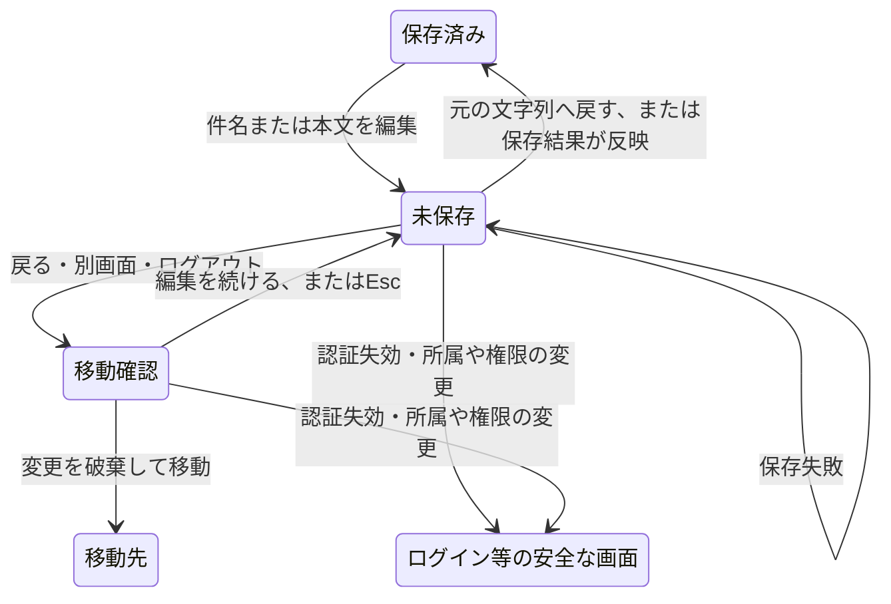

# 下書きを書きかけのまま、うっかり閉じないようにする

## 今回すること

下書きの詳細で件名や本文を書き直したあと、保存せずに別画面へ移ると、今は入力が消えてしまう。移動前に「編集を続ける」か「変更を破棄して移動する」かを選べるようにする。

まずは保存済み下書きの詳細に絞る。「戻る」、別画面への移動、ログアウトを対象にする。ブラウザの再読込や閉じる操作には、対応するブラウザの標準警告を使う。入力を勝手に保存したり、再起動後に復元したりする機能は追加しない。

保存した後や、書き直した内容を元へ戻した後は、余計な確認を出さない。保存に失敗した場合は、入力を残して編集を続けられるようにする。保存や申請の更新中は、途中で別画面へ移らないようにする。

## 採否と承認範囲

選択肢は、今のまま確認なしで移動するか、変更があるときだけ確認するか。入力し直す負担を減らし、通常の移動を妨げない後者を提案した。この計画・仕様・試験ケースは、提示後の「これは非常によいです。その計画で進めて、通常PRを作成し、レビューとチェックに問題がなければマージまでお願いします」で承認された。

通常PRの作成と、レビュー・チェックに問題がなければマージする操作は、今回の会話で依頼されている。仕様書は`docs/specs/request-unsaved-changes.md`。機能・単体試験の草案も同時に提示する。実DB・実データの操作は含めない。

## 調査したこと

2026-10-28、作業rootはMiniFlow。`main`の`5317a43f90dc427308ea338e2a0aed58c0aad8e7`が基点。fetch後も`origin/main`と一致し、作業開始時の変更はない。branchは既存慣習に合わせ`codex/request-unsaved-changes`を予定する。

`RequestDetailView`の編集入力は画面内部の`editForm`にあり、画面が外れると消える。親のナビゲーションは直接`setView`を呼び、「戻る」やログアウトにも未保存の確認がない。`beforeunload`や同等の未保存判定も見つからなかった。作成画面の入力は親に保持されているため、同じ問題として今回一律に変更しない。

既存の`RequestDeleteAction`はnative dialogによる確認とfocus復帰を実装している。見た目と開閉の慣習は再利用するが、削除の確認と画面移動は異なる要求なので、削除の部品に別の役割を足さない。過去の全体レビューR11も踏まえ、親に入力比較や確認画面の描画を集めない。

## 作り方と役割

1. 下書きの入力と保存済み内容の比較を、専用の小さい状態処理へまとめる。本人の認証境界・申請ID・保存済みの件名と本文を基準にし、別の申請や境界へ旧入力を持ち越さない。比較は同じ文字列へ戻った場合も判定する。
2. React用の編集hookが入力状態の寿命を持つ。詳細の入力はここから渡す形へ変更し、旧`editForm`を削除する。通信は持たせない。親は既存の申請APIと移動を接続する役割を保つ。
3. 確認部品は文言・選択肢・開閉・focusを担当する。保留する移動は許可した画面名またはログアウトに限り、任意のURLや外部送信は扱わない。保留中の操作は現在の本人・申請に結び付ける。
4. 画面移動は共通の確認経路を通す。保存・状態変更の送信中は移動を無効にする。成功・失敗・認証失効を区別し、古い確認操作を後から実行しない。
5. 未保存時だけブラウザ標準の離脱警告を登録し、保存反映・初期化・画面破棄で解除する。入力本文を標準警告へ渡さない。

予定する主な変更は`MiniFlowApp.tsx`、専用の下書き編集hookと状態処理、移動確認部品、日英文言、必要最小限のCSS、試験と仕様・記録・ソースの地図。単純な比較と確認の状態を分け、interfaceや汎用のルーターは増やさない。冒頭コメントと公開契約には、入力・保存基準・状態の寿命・失敗時の保持・破棄条件を書く。

既定の見た目の水準Bを採用する。既存の余白・色・focus・dialogの慣習を使う。今回は小さい確認画面なので、外部デザインサービスや新しい画像素材は不要。仮の調整値は予定しない。

図の編集と復元はUF1、確認と取り消しはUF2、破棄移動はUF3、保存・失敗はUF4、安全な画面への初期化はUF5で確認する。送信中の移動は許可しないことをUF4で試す。

## 境界と入力

| 対象 | 契約と守ること | 検証 |
| --- | --- | --- |
| 件名・本文 | 既存の文字列を加工せず比較する。空文字・空白・改行も差として扱い、保存の検証・正規化は既存APIに任せる | 同じ値・元へ戻す・片方だけ変更・空白・改行の単体試験 |
| 移動先 | アプリ内部の許可した画面かログアウトだけ。確認キャンセルでAPIを呼ばない | 保留操作と確定の単体試験、送信カウンターと実画面 |
| 保存・状態変更 | 現在の詳細へ結果が反映されたら基準を更新する。失敗では入力を維持し、自動再保存しない | 500/409と成功の実画面確認。送信中は移動できないことも試す |
| 認証・所属・権限 | 既存の認証失効と境界変更を優先し、確認で妨げない | 旧入力と保留操作を破棄する単体試験・実画面確認・独立レビュー |
| 削除 | 既存の専用確認が破棄を明示するので、未保存確認を重ねない | 削除キャンセルで入力保持、削除成功時だけ詳細を閉じる |

API・DB・migration・依存・認可・入力許容値は変えない。編集状態はログイン中のReact状態だけに持ち、本文や認証情報をURL・ブラウザ保存先・ログ・外部サービスへ保存しない。ブラウザ標準警告は端末・ブラウザの制約があり、障害終了時の復元機能ではない。

## 確認方法と完了条件

重要な確認対象は、UC1〜UC4（入力の寿命と意図した移動）、UC5（認証境界）、UC6/UC7（ブラウザとfocus）。Principles/Commentsの責務は状態処理・編集hook・確認部品・親の接続を最終差分で照合する。Security/Next.jsの認証境界は保留操作の破棄と旧応答の拒否を、Web/UI visualは実ブラウザの日英・通常幅・390px・キーボードで確認する。

設定検査と実行計画を確認してHarnessの文章形式・型検査・全試験・API/Web build・secretsを実行する。lintは既存未整備のためskipped。専用Webと本番HTTPの架空メモリ保存先で、機能試験UF1〜UF7を実施する。既存の一覧位置・削除・認証試験を維持する。必須の実動確認ができない場合は未実施のままマージしない。

確認画面を開いたままの所属変更など、UIが同時操作を許可しない組み合わせは、保留操作の初期化を状態試験と独立レビューで照合する。実ブラウザでの未保存時401・再ログインを別に確認し、同時操作まで実動成功と表現しない。

自己レビューと、認証境界・保留操作の独立AIレビューを行う。最終headのGitHubレビュー完了・指摘解消・失敗/実行中チェックなし・競合なしを確認して通常PRをマージする。CI未設定は成功と区別する。rollbackは今回のcommitのrevertで、データ移行はない。

主なリスクは不要な確認や、保存後にも未保存扱いが残ること、古い保留操作が再実行されること。対応する単体試験と操作試験で確認する。対象を作成・アカウント等の別フォームへ広げる場合や、API・権限・保存方式の変更が必要になった場合は再計画する。
