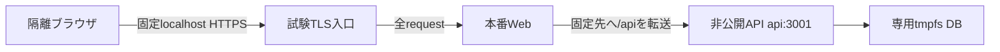

# Webを唯一の入口にする

2026-11-26の会話「PR に問題なければマージしてください。引き続き、公開プレビューに向けた開発とE2Eもお願いします」に基づく。PR32は最新CI成功・未解決threadなしでマージ済み。fetchしたmain aa44b21からcodex/same-origin-previewを作り、元workspaceのホームページ変更は保護する。

現在は試験用proxyだけが/apiを振り分けるため、Web image単体では同一OriginのAPI接続が完成していない。既存Next15の標準rewritesを使い、Docker用Webの/apiを固定内部サービスapi:3001へ接続する。[仕様](../../specs/same-origin-preview.md)と[機能試験](../../tests/functional/same-origin-preview.md)で受け入れる。依存・公開先・TLS・DB schema・認証・UIは変えず通常PRまで進める。新PRは未マージ。

1. next.configのDocker時だけ/api/:path*をhttp://api:3001/:path*へ転送する。利用者に転送先を指定させず、新たな設定値や任意URL proxyを追加しない。通常のホストbuildの接続方式は維持する。
2. ComposeはAPIのpublished portを削除し、実際に到達する内部Host api:3001だけを許可する。DBの固定seed用loopbackは維持し、公開用Composeと誤解しないよう記録する。
3. ローカルTLS試験入口はWebへ全requestを渡すだけにし、旧/api振分けを削除する。APIの正本を本番Webへ移し、試験用の別実装を残さない。
4. 本番Web build、通常build、header/内部到達/直接portなし/Origin拒否を確認し、その同じimageで既存23項目E2Eを実行する。標準407テスト、型検査、秘密/文体検査、独立レビューを実施する。

Security/Input validation → requestのpath/query/headerからdestinationを作らず、内部固定先だけを許可。認証/CSRF/Originの検証は既存APIへ委ねる → Origin拒否と23項目。Web delivery → HTML/static/APIの実header保持とbuild ID照合。Database → 個別承認済み同じ固定localhost:55449/miniflow_container_testだけへ既存9migration/架空4人を投入し終了後破棄する。

責務はnext.configが成果物の配信、Composeが試験ネットワーク、試験proxyがローカルTLSだけ。UI/業務処理を転送側に置かず、既存の同じ知識を持つproxy分岐を削除する。単純な固定転送設定なので単体の実装写しは増やさず、機能試験でCookie/headers/POST/PATCH/queryの到達を実際に確認する。

[Next公式rewrites](https://nextjs.org/docs/app/api-reference/config/next-config-js/rewrites)を参照し、実際のNext15.5.12で確認する。秘密はWebへ渡さない。内部HTTPは専用コンテナネットワークだけに限定し、信頼されないネットワークへ延長しない。公開先のDNS/TLS/アクセス制限・データ復元は未決定で今回作成しない。性能目標は未定、経路追加の負荷/latencyは未検証。lint・依存監査・CI自動E2Eの既存の穴は今回変更しない。

失敗時は公開せず修正して再検証する。DB巻き戻しや既存変更の破棄は行わない。公開先変更、任意転送先、業務仕様や権限変更が必要になれば範囲を見直す。
